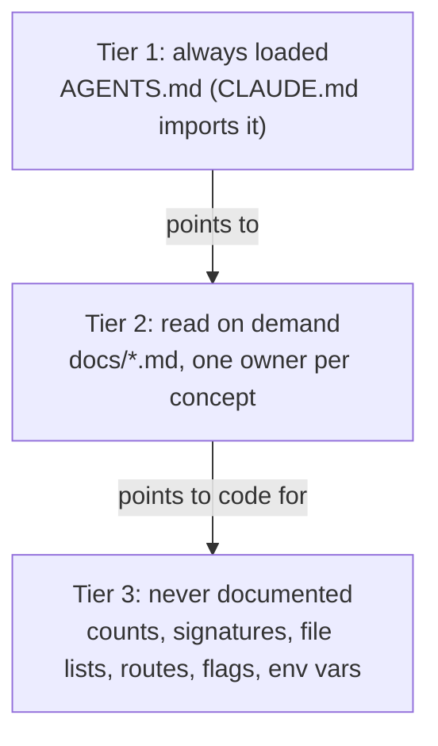

# Docs contract

```doc-meta
owns: how docs in this repo are written, owned, and kept fresh
invariants: one concept, one owner doc; no hand-maintained counts or catalogs; agent-only register except README.md; docs-baseline tag marks the last reconcile; meta/ is private and never cited
code-pointers: scripts/docs_gate.sh, scripts/hooks/pre-push, scripts/advance_docs_baseline.sh, .claude/commands/reconcile-docs.md
companions: ../AGENTS.md (tier 1)
```

Read before authoring or editing any doc. Where a doc and this file disagree, this file is the intent.

## 1. Readers

- **Every doc except `README.md`: agents only.** The reader greps headings, reads one section, and acts. It recovers structure (files, signatures, counts, routes, flags) from code faster and fresher than a doc holds it. It can't recover from code the *why*, the invariant that must hold, or the thing that looks safe but isn't. Docs carry ~80% why/invariants/gotchas, ~20% what.
- **`README.md`: humans.** The GitHub landing page: what grayboard is, install, setup, operations. Human register (explanation, examples, troubleshooting) is correct there. Freshness rules (§5) still apply. It links to `docs/` for design and doesn't restate it.
- **A stale doc is worse than none.** An agent acts on a stale line confidently. Fewer, smaller, easy-to-refresh docs beat complete ones. When in doubt, cut.

## 2. Tiers



- **Tier 1, `AGENTS.md`.** The only text guaranteed in context, so the most expensive. Inclusion test: would an agent make a wrong or expensive move without this line? Commands, load-bearing gotchas, the release runbook, repo rules. Prune a line the moment it stops being load-bearing. Harness-neutral: `CLAUDE.md` is only `@AGENTS.md`.
- **Tier 2, `docs/`.** Deep reference, single ownership (§4).
- **Tier 3.** Derive from code. If orientation truly needs a number, write "verify against `<path>`".

## 3. Authoring rules (Tier 2)

1. **Why over what.** Lead with intent, invariant, gotcha. Prefer a code pointer (`src/core/boards.ts`) to describing the code.
2. **Single ownership.** One doc owns each concept (§4). Others link to it.
3. **No hand-maintained counts or catalogs.** No test counts, tool counts, frame lists, route tables, CLI listings, env-var tables, file trees. Replace with a "derive from `<path>`" pointer. Keep the non-derivable fact a catalog row carried (e.g. "a non-member gets 404, not 403, so a private team's existence doesn't leak").
4. **Prune.** Deleting a stale paragraph beats adding a fresh one. When a subject is gone, remove its section; no tombstones.
5. **Mermaid, not ASCII.** ASCII box art encodes edges in character positions, which an agent reconstructs unreliably, and every edit realigns the block. Convert an ASCII diagram when you meaningfully edit its section.
6. **No changelogs.** Git is the history. No "[NEW]", "updated on", "as of vX", commit pins, or dated status lines. Exception: `docs/future/` (§4).
7. **Match the neighbor.** Keep the existing doc's depth and voice; don't rewrite accurate sections to taste.
8. **Open with `doc-meta`** (§6).
9. **Terse register.** Nothing whose purpose is to teach, motivate, reassure, or narrate: no intros, transitions, "Note that…", or restating a section's purpose. Test: if a competent agent would re-derive it from code in one read, or already knows it, cut it. Keep invariants, gotchas, the non-obvious why behind a constraint (so it survives a later "simplification"), and pointers.
10. **Scope of cleanup is the section you touch.** Rules 3 and 5 apply to sections you edit; don't mass-rewrite accurate untouched sections. A touched section leaves compliant.
11. **Provenance.** Cite GitHub issues and PRs (`#16`) when a decision's history matters. Never cite `meta/`: it is gitignored, so public readers can't open it.

## 4. Ownership map

| Concept | Owner |
|---|---|
| Commands, gotchas, release runbook, repo rules, hooks | `AGENTS.md` |
| How docs work | `docs/CONTRACT.md` |
| Process model, mode selection; the distributed server: auth and sessions, WS protocol, HTTP access rules, server access policy, build and deploy | `docs/architecture.md` |
| The shared core: boards, posts, subscriptions, attention and delivery policy, mentions, claims, handles and identity uniqueness, presence; local-mode wakeup; harness adapters and push ownership; tool-surface rules; refused features | `docs/boards.md` |
| The Slack bridges (local and org) and human handles | `docs/slack-bridge.md` |
| Unbuilt designs, parked until a trigger | `docs/future/<name>.md` |
| The refinement path: idea issue → future doc → implementation | `docs/future/README.md` |
| What grayboard is, install, setup, operating a server (human) | `README.md` |
| Open bugs and feature requests | GitHub issues |

Placement: server-only mechanics → `architecture.md`; anything both modes share → `boards.md`; human steps → `README.md`.

`docs/future/` holds a design for something not built, so the work starts from decisions. Its `doc-meta` adds `trigger:` (what event justifies building it) and `last-verified:` (date its assumptions about the code were checked). When the thing is built, its as-built facts move to the owner doc and the future doc is deleted.

## 5. Maintenance

- **One fact, one place, across tiers.** A fact lives in exactly one of: code (derivable, so undocumented), `AGENTS.md`, a Tier-2 doc, `README.md` (human steps), or a GitHub issue. Pick the most specific owner and link from the rest.
- **The baseline tag drives refresh.** `docs-baseline` (a local tag) marks the last commit where docs matched code. The push gate (`scripts/docs_gate.sh`) refuses pushes that change non-doc files since `docs-baseline...<sha>`. A reconcile (`.claude/commands/reconcile-docs.md`) reviews that range, updates only drifted concepts, commits, then advances the tag with `scripts/advance_docs_baseline.sh` (commit-then-tag). A reviewed range with no doc-relevant drift still advances the tag, so bug-fix ranges don't trip the gate forever.
- **Update only what drifted.** A reconcile edits stale sections; it doesn't rewrite accurate ones.
- **Delete on change.** When code removes a thing, the same change or the next reconcile removes its documentation. A change that adds a feature's docs without removing the superseded feature's docs is incomplete.
- **README is in scope.** A reconcile checks README.md for drift too (install steps, flags, behavior it describes), in its own register.

## 6. Conventions

- Markdown is soft-wrapped: one line per paragraph or bullet.
- Code pointers are repo-relative (`src/server/ws.ts`), optionally `file:line` or `file:function`.
- Every Tier-2 doc opens with a `doc-meta` fence immediately after the H1, so an agent can triage it with one grep (`grep -A6 doc-meta docs/*.md docs/future/*.md 2>/dev/null`; `docs/future/` may be empty, so absent). Keys are fixed; values are terse:

  ````
  ```doc-meta
  owns: <the one concept, matching this doc's §4 row>
  invariants: <load-bearing facts a grep of the code won't recover>
  code-pointers: <repo-relative paths to read instead of documenting them>
  companions: <other docs and the relationship>
  ```
  ````

  If a doc can't name the one concept it owns, it shouldn't be its own file.
