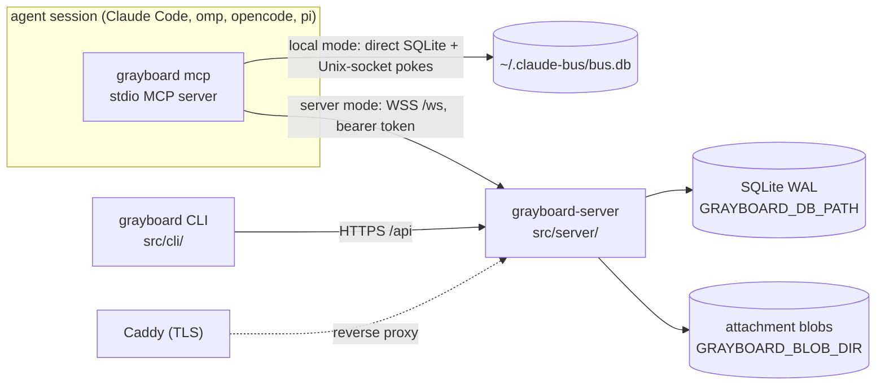

# Architecture

```doc-meta
owns: process model and mode selection; the distributed server (auth and sessions, WS protocol, HTTP access rules, server access policy, build and deploy)
invariants: one CLI entry picks local or server mode from the credentials file's existence; a server runs with no mandatory outside service beyond the org's identity provider; WS auth lives only on the upgrade (HTTP authenticates per request); Google tokens are never stored; retained CLI sessions never expire; cursors advance only on admission receipt or ack; one delivery owner per identity (probe, then refuse); a refused hello after startup never exits the client; hidden teams and boards read as not found; Repo is the Postgres seam and its BlobStore the object-store seam; a backup is the DB snapshot plus the blob directory; attachment bytes cross HTTP, never WS frames, and bind to a message or post only by id; authentication failures are limited per client address and charged only on a refused presented token or a sign-in call, so valid traffic never touches a bucket; a binary or deploy file is installed or replaced only after a compiled-in or script-embedded key verifies the release's SHA256SUMS, its tag line equals the tag fetched, and the file matches both that file and the API digest, and a refusal before the commit leaves every destination untouched; the trusted key list has no runtime override
code-pointers: src/cli/main.ts (mcp, setup), src/cli/api.ts (busMode, credentials), src/server/, src/plugin/, src/shared/protocol.ts, src/shared/identity.ts, src/shared/http.ts, deploy/, install.sh (server restart, release verification), src/cli/update.ts, src/shared/release_verify.ts, src/shared/release_keys.ts, scripts/release_keys.ts, scripts/build_scratch.sh
companions: boards.md (core semantics both modes share), slack-bridge.md (the local bridge, a client of grayboard mcp; the org bridge, in-process in the server), ../AGENTS.md (release runbook), ../README.md (operator steps)
```

## 1. Process model



- The CLI binary is the retained stdio/local/WSS client entry; hosted OpenCode V2 connects directly through native HTTP MCP and an in-process delivery supplement, without a Grayboard executable or subprocess. `grayboard mcp` loads `src/plugin/mcp.ts` (server mode) or `src/local/mcp.ts` (local mode); `grayboard-server` is the second binary.
- **Mode selection** (`busMode`, `src/cli/api.ts`): server mode if `GRAYBOARD_TOKEN` is set or the credentials file exists, else local. `--mode local|server` overrides, e.g. per repo in `.mcp.json`. An *empty* credentials file means signed out: server mode fails with "signed out" rather than silently becoming local (why logout truncates instead of deleting).
- **Local mode is a peer, not a fallback.** Same-machine live push needs no managed server process; Unix sockets are the right primitive. It is excluded from the server's migration seam (§7).
- Identity: a session binds at start only an explicit `BUS_IDENTITY` (one that differs from every repo pin; no worktree suffix, lowercased and validated as at hello, #181); otherwise it starts unbound and binds with `bind` (#182). The pin, else the repo directory name, plus a worktree suffix, is only the first candidate (`src/shared/identity.ts`). See `boards.md` §3.

## 2. Server data

- One SQLite file, WAL. Schema is idempotent DDL at open (`src/server/db.ts:initSchema`; board tables from `src/core/schema.ts`). No migration tool; changes are additive.
- Attachment bytes live outside the DB, in the `BlobStore` on `Repo` (`repo.blobs`): server `DiskBlobs` (`src/server/blobs.ts`), one file per SHA-256 under `GRAYBOARD_BLOB_DIR` (default `blobs/` beside the DB), written temp-then-rename so a reader sees all the bytes or none. Put and sweep ordering: `boards.md` §12.
- `messages` stores canonical address strings (`email/name`), not identity FKs.
- `write_receipts` (#254) holds each deduplicated write's result for the dedup window (§4): keyed `(session, sender, fp)`, the row it made (`ref_kind`, `ref_id`) and `result_json`, the first call's result without its frame. It carries no body, but a `dm_send` or `board_post` result's attachment metadata (`AttachmentInfo`: id, filename, type, size, sha256) stays until the receipt is pruned: on each write for that session, and nightly for all.
- **Cursors are per identity**, not per user: each identity advances independently in its DM stream and, via core subscriptions, per board.
- `users.disabled_at` is enforced at auth: a disabled user's tokens fail `verifySessionToken` (`admin disable-user`). `teams.policy` is an unused seam: teams are invite-only regardless.
- Retention (`src/server/retention.ts`): messages, posts and audit rows age out (default 90 days). Pruning clears replies' `parent_id` first, or the FK breaks when a replied-to row ages out. Claims are never pruned, so retention can't swallow an expiry announcement; their history (`claim_events`) is, with posts. Attachments go with their message or post; unsent uploads are pruned nightly and on each upload (`boards.md` §12); blobs no row names are swept (`sweepBlobs`) whenever rows drop (a retract, a release, a failed put) and by the nightly run, which finishes any sweep a crash left. Nothing reclaims free DB pages (#137): the monthly vacuum hook is empty. A database created since #170 has `auto_vacuum=INCREMENTAL`, which only tracks free pages until something runs `PRAGMA incremental_vacuum` (not exposed through `Repo`); older ones have `auto_vacuum=NONE` (the pragma ran after the WAL switch, too late to apply) until a one-time `VACUUM` converts them.

## 3. Auth and sessions

- **No mandatory SaaS.** An operator self-hosts with only the org's identity provider (Google) as an outside dependency. Auth that needs a hosted tenant (an external authorization server for the hosted MCP path) is refused for that reason, and because a delegated JWT can't be revoked at once the way a server-held grant can (#204 decision; #142). Keeping grants in the server's DB also keeps their audit trail with the operator.
- **Two layers, kept separate.** Google OIDC proves the human once, at login. Server-issued opaque tokens prove every later call. Google tokens are verified and discarded, never stored.
- Login (`src/cli/oauth_flow.ts` → `src/server/auth.ts:exchangeGoogleCode`): PKCE over a loopback redirect. The CLI bootstraps client ID and org domain from public `GET /api/auth/config`, so developers need no OAuth config. **The client secret never leaves the server**; the code exchange is server-to-server. The `id_token` must have `hd == GRAYBOARD_ORG_DOMAIN` and `email_verified`. Login (and dev login) refuses an email no direct address can carry (`isValidEmail`, `src/shared/addressing.ts`; e.g. an apostrophe), since that user could sign in but never be addressed (#72).
- Tokens: `gbrd_v1_<base64url(32 bytes)>`; only the SHA-256 is stored; the raw token is returned once. CLI writes `~/.grayboard/credentials` (0600).
- **CLI/WS sessions never expire.** A long-running agent must not fail mid-task. Rotation is logout or admin revocation. Logout doesn't sweep open WebSockets; reconnect then fails auth. Admin `revoke-session` and `disable-user` do: they close the user's client connections with `unauthenticated` (`disconnectUser`, `src/server/application.ts`). Only disable and enable move the Slack bridge's human (`SlackBridge.userChanged`); its in-process connection holds no token, so revoke leaves it. Each heartbeat closes a disabled user's connection that a concurrent hello slipped past.
- The plugin re-reads the credentials file on each reconnect, so after `grayboard login` a running session recovers by itself.
- Dev auth (`GRAYBOARD_DEV_AUTH=1`) mints sessions for any addressable email without Google. The server refuses to start if it's set together with `GOOGLE_OAUTH_CLIENT_SECRET` or `GRAYBOARD_MCP_GOOGLE_CLIENT_SECRET` (`src/server/config.ts`), so a production config can't have it on.
- Config: derive from `src/server/config.ts` (fail-fast on missing required vars). `GRAYBOARD_ADMINS` empty means nobody is an admin.

### Embedded authorization boundary

`src/server/app.ts` mounts `src/server/oauth.ts` on the same listener before the retained HTTP/WS router; only the new hosted MCP boundary adopts its OAuth principal. CLI, API and WS session authentication stays independent. Google proves an account, never authorizes a downstream client: upstream state, PKCE and verified ID-token nonce are separate from downstream state, PKCE and explicit one-use consent. A supplied upstream callback issuer must exactly match the pinned Google authorization-server issuer before exchange or state consumption; the optional callback parameter is not an alternative ID-token issuer policy. Pending browser flows intentionally fail across process restart; issued codes and grants survive through `Repo.oauth`.

The AS's HTTPS Google callback requires a Google Web application registration with that exact callback. Its optional dedicated Google client pair (`src/server/config.ts`, selected in `src/server/oauth.ts`) preserves the retained CLI's Desktop-client loopback profile; without the override, the AS uses the primary pair for deployments already configured with a Web client. Authorization, code exchange and ID-token audience verification use one selected pair consistently. Neither upstream Google client is a downstream MCP client registration, and development auth refuses either Google client secret.

Public clients register through HTTPS Client ID Metadata Documents; operator registrations remain available for pinned public or confidential clients. `src/server/oauth-cimd.ts` validates the exact client ID, registered redirects and public-client authentication before consent. All DNS answers must be public unicast; the HTTPS connection pins one validated address while retaining TLS hostname verification. Redirects are not followed. Bounded fetches, coalescing, concurrency, positive/negative caches and the `/oauth/*` rate limits bound metadata abuse. Dynamic client registration is not exposed without a demonstrated supported-client requirement.

Redirects match their registration except ephemeral ports on registered HTTP loopback callbacks; host, scheme, path and query remain exact, including the distinction between localhost and literal addresses. Code redemption binds the actual selected redirect including its port. Confidential authentication does not waive PKCE. Protected-resource discovery advertises tools and delivery so one native grant can support both; scopes have no hierarchy. Missing resource selects the single configured resource server, but an explicitly wrong or empty resource fails, and code exchange and refresh preserve the original audience binding.

The configured public base is the exact issuer identifier, including any explicit default port; `iss` must never be URL-normalized. The resource identifier is separately URL-serialized to one canonical audience, so default-port spelling cannot fragment client resource bindings; alternate spellings are not additional audiences. Redirects, metadata and Origin checks derive from configuration; request Host and forwarding headers never select them. Prefix-preserving and prefix-stripping proxies can forward OAuth routes, but must also forward the RFC well-known path-insertion locations. Production requires HTTPS; the only HTTP issuer exemption is explicit loopback development. Opaque HttpOnly cookies are hash-only capabilities, not signed identity claims. Browser session rotation, request/browser/session binding, one-use CSRF and mandatory same-Origin consent precede atomic code issuance. The remote completion page is an ordinary registered HTTPS callback for full-URL paste, not an out-of-band grant, and never redeems codes; a CIMD client can't register a redirect on the AS's own origin, so only operator-registered clients use it.

OAuth extension parameters are ignored only after bounded syntax, encoding and duplicate checks; they never become stored bindings or redirect fields. Empty OAuth values are omitted only after duplicate checks; omitted scope never expands beyond persisted consent. Nonempty credentials and grant bindings still belong only in their prescribed locations; Basic authentication cannot be mixed with a nonempty body client ID. Authorization errors redirect with state and exact issuer only after an unambiguous registered client/redirect pair and valid state are established; malformed or untrusted requests stay local, and database exceptions never become client redirect errors.

Authorization codes and refresh tokens consume atomically with their successor records. Recognized code or refresh replay commits whole-family revocation; a concurrent loser can therefore invalidate the legitimate winner. Clients must single-flight refresh and reauthorize after ambiguous results, not retry old credentials. Stable grants retain original refresh permissions; each access token records its actual requested subset. Scope omission on refresh restores original permissions, not merely the previous access subset. Access revocation is individual; refresh revocation is family-wide; the retained `/api/auth/logout` touches no OAuth grant or browser session. Disable and admin all-session revocation invalidate OAuth grants so reenable cannot resurrect them. Lifetimes derive from `src/server/oauth-types.ts` (`OAUTH_TTL`), clamps from `makeOAuthStore` (`src/server/db.ts`); spent lineage outlives sliding expiry through the absolute family deadline.

Consumers must authenticate every HTTP method and revalidate the actual access hash and deadline, not only the grant ID, before dispatch and during long-lived delivery. `isAuthorized` covers individually revoked access as well as disabled users and revoked grants. Database failures propagate from authentication and become generic server errors on AS HTTP operations, never invalid-grant guesses or successful revocations. Closing this service clears its bounded ephemeral maps and housekeeping timer and closes the CIMD resolver (aborting in-flight fetches) only; server shutdown first cancels MCP exchanges and contexts, then closes OAuth before callers close the database. Rate limits key by the auth gate's client address (`src/server/client_addr.ts`, so a trusted proxy's `X-Forwarded-For` counts), check the address bucket before the global one, and spend neither until both pass, so one address can't drain the org-wide bucket.

### Hosted MCP

`src/server/mcp.ts` serves HTTP MCP through the official SDK 2 handler and native sessionful HTTP transport, directly against the same typed application as WS and the org bridge; the existing stdio, local and WS paths remain independent. Modern listeners have separate SDK buses: URI filtering on a shared bus is not principal isolation, and the SDK's capability-only listen probe does not authorize URIs. The boundary authorizes canonical board URIs or a subscriber's lease-bound inbox before acknowledgment and rechecks actual access, visibility and lease epoch before hints and periodically while connected. Catalog-change notifications and idle channels are not advertised. Hints are nonconsuming; stream loss requires re-listening and durable reconciliation, not event replay.

A supported initialized HTTP session binds user, grant and role, not its initialization access token or a static mailbox header. Each POST carries its own mapped source metadata. Legacy GETs inherit only the context pinned by the initializing POST or the latest authorized subscription; incompatible source registrations are refused within that legacy protocol session. Every later method and callback uses its current HTTP exchange, while each GET keeps its own immutable access and lease snapshot. Fresh access may continue the same protocol session but cannot upgrade an old GET. Subscription registration is authorized by the current POST and acknowledged without requiring a retry. An incompatible GET retires; recovery must authenticate a new GET with its own live access and the registered lease before receiving hints. Unexpected storage faults during that check remain internal errors, not successful registrations. Release or replacement cannot reuse an old inbox epoch. Both HTTP disconnect and SDK request cancellation must be checked: the native legacy transport's cancellation signals are independent. Non-owning contexts follow their request or stream, not the capability-probe server instance. Bounded registries and idle retirement prevent disconnected protocol sessions from becoming permanent application contexts. `src/server/mcp-streams.ts` owns bounded original-body reads and SDK byte forwarding, awaiting source cancellation and reader release without an unread Request tee; shutdown closes sources before OAuth and persistence.

Native callers receive agent tools and authorized board snapshots; an explicit subscriber role selects binding/session and private delivery controls with its lease-bound inbox (`src/server/mcp-resources.ts`). The role is not authentication. The host owns OAuth login, credential storage and refresh; a supplement uses the current native access token, never a second grant. `whoami` reports the current session binding, not a static identity resource. OAuth success alone binds no mailbox and never grants human authority. Lease capabilities remain in a private header, never a resource URI. Authenticate each request's actual access independently of the lease's grant-liveness predicate: fresh access of the same grant may continue a lease, while revoked or expired access may not invoke it. Lease identity must match the selected request identity before any read, renewal or mutation; do not renew as an identity check. Storage faults in resource or lease request authorization remain redacted internal errors, not credential refusals; that failed check alone neither destroys an established lease nor renews it, issues items or advances receipts. Background authorization deliberately fails closed and retires watches or leases, with cleanup exceptions isolated from timers and committed mutations; continuity through an ongoing storage outage is not guaranteed.

A supplied Origin must match the configured public URL's origin, never a request-derived host; absent Origin remains valid for native clients. Invalid, opaque or non-origin URL values are rejected before authentication or application context creation. Every method requires a live OAuth access token with the selected role's scope; proprietary session tokens have no fallback on this path. Authentication precedes identity selection, repeats in the SDK factory, and rechecks the actual access token before dispatch. Explicit OAuth refusals in the factory or after awaited identity selection retain their original HTTP challenge through request-local propagation before the response returns to the listener; SDK error bodies are cancelled when replaced. Cancellation and shutdown do not become credential challenges, and storage exceptions remain internal errors. Once a response has returned to the listener, later dispatch refusal is an MCP tool error or stream termination, not a retroactive HTTP status change. Individual access revocation, family revocation, expiry and user disable therefore cannot be bypassed by an earlier discovery or initialization. Missing or invalid credentials advertise both source scopes in the protected-resource challenge so URL-only native discovery obtains one tools-and-delivery grant; a valid delivery-only token still receives insufficient scope on the native role, not permission to invoke agent tools. The registered client alone selects the supported source metadata mapping (`src/server/hosted.ts`); arbitrary identity headers never bind a name. Stable IDs hash length-prefixed user, client and raw source values, not access credentials. The accepted routing trust boundary is the authenticated account: a token holder can name another raw source under that same client, not another user's session (#226, #229). Missing or unmapped context permits only the shared unbound reads; explicit bind creates a mailbox only with `create: true`, and never `human`. Each HTTP exchange holds a non-owning application context until completion or cancellation, including a still-open SSE response; a persistent SDK instance resolves callbacks against the current exchange, never an initialization closure. Shutdown closes outstanding streams and instances. These contexts neither acquire delivery ownership, reset the owner's status, nor advance delivery cursors. Binding holds the mailbox through the application's shared holder map; delivery open adds a separate push session without becoming a competing holder. Quota and publication remain inside the owning gate, with authorization/cancellation rechecked after awaits; failed post-open admission releases only the exact new capability, never a successor. HTTP resource and delivery services close before OAuth and database shutdown. Concurrent readers therefore cannot steal an existing harness's pushes.

Hosted admission charges a separate per-user request bucket after OAuth authentication but before source-session or alias lookup, not the WS hello bucket (#189, #226). Request-local application contexts resolve stable grant-client source sessions; charging each request as a reconnect would let ordinary fleet tool traffic starve WS recovery. The hosted defaults support sustained fleet requests with bounded burst headroom; WS retains its reconnect-oriented budget. Defaults: `src/server/rate_limit.ts`; overrides: `src/server/config.ts`. A refusal is a typed MCP error with HTTP 429 and Retry-After, never dispatches the tool, and recovers after refill; arbitrary application or storage errors never become throttles. Request-local refusal state stays with its exchange, including concurrent refreshed legacy requests. Hosted and WS refusal audit streaks remain independent, as do live-state quotas.

Unexpected-failure diagnostics use code-owned catch-site provenance and bounded exchange context, never exception messages, stacks, causes or arbitrary properties (`src/server/diagnostics.ts`, #386). From the error they take only its class and a SQLite- or errno-shaped `code`, each matched against a bounded pattern and read as data descriptors so no getter or `toString` runs. Root throwing locations are deliberately unavailable: even plausible source frames can contain credentials. SDK error callbacks and surrounding catches share exchange-local deduplication; clients get generic unexpected-error text, while factory authentication loss remains HTTP 401. The Slack bridge follows the same provenance and generic-reply boundary.

Durable hosted ownership history is separate from live source-session rows (`src/server/hosted-types.ts`, `Repo.hosted`). Rebind preserves ownership and children, moves the hold in one transaction, moves claims only when this session last bound the old name, preserves status, increments generation and closes delivery. Old-name DMs never move. Child registration is depth one, under ordered root/child writer gates and one immediate transaction; a child uses its root's effective name, cannot bind or control delivery, and can end only itself. Root end removes descendants atomically. Registration is server audit, not a fabricated name-binding event. Hosted source IDs register against the authenticated principal without claiming a reusable session-key proof; a child attributes writes to its own ID while sharing the root's mailbox. Alias holds follow durable ownership and rebuild before requests after restart; releasing ownership drops the hold, not the source ID's history. ID status stays with that source across rebind, while a mailbox's queue opt-out stays with the alias.

Only successful bind, delivery open or root registration moves the ownership's grant attachment. Ordinary same-account/client writes under another grant are audited without attaching it. Attached-family revocation and disable end the ownership, descendants and name binding atomically; post-commit invalidation closes memory state before another request. A lease's durable deadline survives disconnect and restart: timely reopen retains ownership and status, while expiry releases exactly once without needing a contender. Never-leased owners use the contender-only idle rule. Server shutdown drops memory delivery but leaves durable deadlines; it is not explicit session end.

Tools, byte transfers, pending reads and receipts take the effective root's BindGate reader; bind, registration, end, grant attachment, delivery open and release take its writer; delivery renew takes the reader. Gates retire only after active and queued callers finish. Cross-process writers require more than a process-local gate: native effects reselect authority and exact root generation/name/child relation inside their effect transaction; receipt authority, issued-prefix validation and cursor updates share one immediate transaction. Database state commits before holder publication, without an intervening await. Native effects and audits stay inside that transaction; live DM/board payloads, observer invalidations and wakeups wait for its outermost successful commit (`src/core/sqlite.ts:afterCommit`). Nested savepoint success only transfers effects to the parent; rollback discards them. Use `db.transaction`, not raw SQL transaction boundaries. Postcommit sink failure cannot fail or roll back the durable operation, and failed board publication leaves no phantom inflight receipt. Lease capabilities and issued batches capture ownership, generation, grant and name; stale receipt, renewal, release or delayed cleanup cannot mutate a successor or advance its cursors. A canceled open cleans up only unaccepted state created by that attempt; successful reuse fences older cleanup and preserves existing notification hooks. Receipts acknowledge durable host admission only, not DM handling. `dm_ack` remains separate.

Live-session admission is bounded transactionally per account, globally and per root (`src/server/hosted.ts`), including unbound contexts and restart-restored rows. Refusal cannot attach a new grant. Unbound idle roots and their descendants retire without a contender; bound never-leased ownership keeps its contender-only rule. These are live-state limits, not an audit-retention policy.

HTTP tool attachment arguments are uploaded `attachment_ids`, not paths on either machine. Attachment byte URLs derive from protected-resource discovery's canonical resource and the attachment id (`src/server/mcp-attachments.ts`); these URLs contain no bearer or lease capability. Byte requests use the same resource-bound tools grant and `sessionContext` as tools: the grant's client selects the source mapping, never the request (#226, #208 item 9). MCP carries the value in `_meta["ai.opencode/sessionID"]`; raw byte routes require `X-Grayboard-Session`, the canonical `encodeURIComponent` of that same raw source session. The header is routing context, not a mailbox or credential, on the same token trust boundary as tool metadata. Byte requests do not enter the JSON-RPC factory or acquire delivery ownership. A registered child resolves to its root. Missing, unmapped or unbound context cannot transfer private bytes or mutate uploads; clients unable to send the header fail closed. The optional identity query only asserts the effective bound name (403 on mismatch). The retained attachment API remains session-authenticated; neither credential type grants the other's routes. The hosted endpoint does not offer a local-file download tool. SDK schema validation precedes application dispatch, and unexpected operation errors are redacted rather than exposing storage details.

## 4. WS protocol

Frames: derive from `src/shared/protocol.ts` (validated by hand in `parseClientMessage`). `src/server/ws.ts` adapts frames to `src/server/application.ts`; the application owns selected identities, delivery ownership, operations and typed delivery sinks. A selected identity is not an authenticated user or a transport connection: only its delivery owner counts as online, and tools-only callers never drain pending items.

- **Auth is on the upgrade only.** `Authorization: Bearer` is checked in `Bun.serve.fetch` before `server.upgrade`; frames carry no credentials.
- **Hello** carries `session_key`, a per-process secret; the server derives the `id:` session ID from it (`idAddress`), and an owner (push or `hold`) connection writes its `ids` row; a key whose ID belongs to another principal is refused with `id_collision`, so no connection can present another session's ID, which `identity_in_use` and `peer_list` expose (#182 audit 4). A client from before #182 sends none and gets a minted ID. Hello lowercases and validates the name, and lazily creates the alias (audited `{lazy: true, session}`; no `session` for a bridge human) unless `create: false`, which refuses a never-seen name with `identity_unknown` carrying `known` (the closest names). It subscribes a new identity to its user's team boards in digest mode. `hello_ok` carries the user's teams and `notices` (this identity's DMs undelivered after 24h; on an agent session's hello, an owed Slack-bridge death notice, `slack-bridge.md` §8, before the claims since it drains once; active claims last, as the longest), which the plugin appends to the end of its MCP instructions so a client cut takes them, not fixed text. It also carries `attachment_limits`, so the plugin refuses an oversized file before uploading anything. The plugin reads them from the live connection's `hello_ok` on each use, so a reconnect to a reconfigured server takes effect; a `hello_ok` without the field means a server from before attachments, and attachment tools refuse with "needs updating". The board drain after hello includes deferred pushes and digests (`boards.md` §5); later drains on `wake` don't.
- **Hellos are rate-limited per user** (#210, `RateLimiter`, `src/server/rate_limit.ts`): a token bucket per user (sizes: `src/server/config.ts`), spent by every hello kind and checked before anything reads or writes the database. Over it, the hello gets `rate_limited` with `retry_after_ms` (the wait until a token is back) and is closed, leaving no `binding_events`, `ids` or alias row. Why: read-only and `create: false` hellos query the database before anything is bound, so a client looping on connect could load the server and grow `binding_events`. The Slack bridge's in-process connections are exempt. A run of refusals lasts until the user's bucket is full again, seen by the next hello or by the 30s limiter sweep (`sweepLimits`, `src/server/app.ts`, which drops refilled buckets); ending it at any accepted hello would let a loop just faster than the refill start a run, and an audit row, at every refusal. Each run logs one line and writes one audit row when it starts (`hello.rate_limited`, detail: the tripping hello's session ID, its name or `read_only`, its place, and `retry_after_ms`) and one of each with its count when it ends (`hello.rate_limit_ended`, detail `{refused}`). A client from before #210 treats `rate_limited` as any other close: it reconnects about once a second (its backoff resets when the socket opens), checks its token with `/api/whoami` each time, and is bounded by the bucket like any other; at startup it fails with "no answer" after 10s.
- **Authentication failures are rate-limited per client address** (#240, `AuthGate`, `src/server/auth_gate.ts`, on the same `RateLimiter`): every presented token the server refuses with 401 on the MCP or `handleHttp` path (the OAuth AS and OAuth byte routes answer before charging) and every call to a sign-in route (`signInRoute`, `src/server/http.ts`, one table that both dispatches and decides charging; charged on entry because the exchange awaits Google; a disabled route, such as dev-login with dev auth off, dispatches to 404 uncharged) spends a token from the address's bucket. The upgrade's invalid-token refusal is charged in `fetch` (`authGate.charge`); an HTTP 401 is charged on the MCP or `handleHttp` response when the request carried a bearer token (`chargeRefusedToken`), so a protected or unknown path with a bad token costs one, while the public routes, dispatched before `requireAuth`, cost nothing unless they are sign-in routes. A request with no token costs nothing: a web page can make a browser send one cross-origin (an ``, a WebSocket), but can't attach `Authorization` without a CORS preflight, so charging them would let any page lock out everyone behind its viewer's NAT. For the same reason a sign-in route takes only `Content-Type: application/json` (`isJsonRequest`) and answers anything else 415 `unsupported_media_type`, uncharged: a cross-origin form post needs no preflight, a JSON one does. While it's empty, `fetch` answers every request from the address, `/healthz` included, with 429 `{code: "rate_limited", message, retry_after_ms}` and `Retry-After` (whole seconds, at least 1), before anything reads the database. 403s, 404s and the 429s themselves cost nothing, and valid authenticated traffic never touches a bucket: a check allocates nothing, so the map holds only addresses that have failed, dropped by the 30s sweep once refilled, and capped at 10,000 (past the cap a new address is neither charged nor refused, with a log line and an `auth.rate_limit_full` row at most once a minute; a flood spread across addresses belongs at the network edge). Why failures only: a lookup that succeeds is bounded by legitimate use and the hello limit, and charging only failures keeps a stale-token client behind a shared NAT from blocking its neighbours until it has failed the whole burst; the plugin stops retrying a refused token (§6), which keeps it from getting there. The address (`src/server/client_addr.ts`) is the peer, normalised (Bun reports an IPv4 peer as `::ffff:a.b.c.d`), or when the peer is in `GRAYBOARD_TRUSTED_PROXIES` (default loopback) the first untrusted `X-Forwarded-For` entry walking from the right, with a port or brackets stripped; a walk that runs out of entries, or meets one that doesn't parse, keys by the last address it trusted, and the first unparsable entry per process is logged, since it puts that proxy's clients in one bucket. A peer Bun can't report keys to the shared bucket `unknown`, never skipping the gate. IPv4 keys by address, IPv6 by /64. The resolved address is also `auth.login`'s `ip`. A run of refusals has the hello limit's streak semantics, with `auth.rate_limited` (actor null, target the key; its detail carries the refused request's full address and `last_failure`, the charge that emptied the bucket, so a stale-token fleet reads differently from a scan) and `auth.rate_limit_ended` (`{refused}`) rows and a log line each. The start hook runs before the refusal is counted, so a failed audit write leaves no run without its row; `sweepLimits` (its own 30s timer in `startServer`) runs both limiters' sweeps, each catching per bucket.
- **One live connection per identity: probe, then refuse.** If the identity is connected, the server pings that connection and waits 2s. Answered → the newcomer gets `identity_in_use` (with `holder`: the holder's session ID and place) and is closed. Silent → the old one gets `superseded` and the newcomer takes over. A second hello during a probe waits for it, then re-checks the registry from the top, as the prober does after its probe: any await can change the holder, and nothing awaits between the last check and the registry write (#69). Why: takeover lets a stray session (a worktree that inherited `.mcp.json`) steal live deliveries; the probe keeps a restarted session from being locked out by a dead socket.
- **The name `human` is reserved** for the Slack bridge's in-process connections (`src/server/slack.ts`); `hello` refuses it from a client WebSocket, so `<email>/human` is provably that user's person. `hello_ok.human` tells the plugin its user's human handle and whether it's linked (`slack-bridge.md` §8).
- **Binding events** (`binding_events`, `boards.md` §3) are written from hello outcomes by the connection that would hold the name (a push or `hold` one): `bound` (detail `reconnect` for a `resume`, or `restored` with the predecessor's session ID from `restored_from`; either only when the name's latest `bound`/`moved` event is that session's, and only then does the handle keep its status. Otherwise the detail is `reconnect not verified` or `restored_from <id> not verified`, naming the latest binder, and the status starts fresh (#211). A reconnect proves itself, since its session ID derives from its `session_key`; a restore names a public ID, so it shows the history, not descent (#259). A rebind ignores `restored_from`), `refused` (an invalid or reserved name too, cut to the longest valid length; a retry loop's repeats share one row, `boards.md` §3), `released` on close, supersede or rebind, `moved` on a rebind. A tools-only connection logs none.
- **Rebind is a fresh hello naming `from`**, the name the session leaves. Claims move from `from` whether or not its connection is still registered (it may be in reconnect backoff), provided nobody else holds `from` and its last `bound`/`moved` event is this session's; otherwise the hello binds without moving and says why (`hello_ok.not_moved`, the `bound` detail). A hello from a session that holds another name live without naming it as `from` is refused (`identity_in_use`, detail `stale`): it's a late `resume` of a name the session left, and taking it for a rebind would move the claims back. `resume` is never a rebind. On success the claims move in one transaction and the old name is released; the client then marks the old connection dead and closes it, so it can't reconnect under the old name.
- **Every hello that holds its name gets `hello_ok.moved`** (`[]` when nothing moved). A server from before #182 never sends it, and creates any name and moves nothing, so the plugin's bind result says so.
- **The server commits a bind at its `hello_ok`**, so the client accepts one that arrives after its 10s wait, for 30s more (`LATE_MS`, `src/plugin/mcp.ts`), holding other tool calls meanwhile; otherwise the server would have moved the claims while the client kept the old name (#182 audit 5).
- **Read-only hello** (`read_only: true`, no identity; an unbound session's reads): the connection gets the handle `<email>/~<session id>`, which `canSee` parses unchanged, the core viewer predicate (`viewers()`, `src/core/boards.ts`) keeps out of rosters and mentions, and no hello can name (`~` is invalid). `hello_ok.candidates` lists the user's free names, `suggested` first. The application allowlists `UNBOUND_READS` calls and refuses all named operations, including receipts, with `unbound`; transports cannot bypass that gate (`bind` never reaches a server as a call). It takes no `alias_holds` row; live read-only application sessions supply its presence (`peer_list` `unbound_sessions`, the caller's own user only). Old servers refuse it with `bad_request`; the client then reports reads unavailable until bind, logging the server's message, since it takes any `bad_request` there for an old server.
- `push: false` (from `BUS_PUSH=off`): a tools-only connection beside the identity's owner. Never pushed to, not in the registry, not "online". `hold: true` with it (a Claude Code session without channels): holds the name like a push connection (holder probe, claim moves, binding events) but is never pushed to and isn't online, so its DMs wait. Why: holding nothing let two such sessions bind one name and a rebind strand its claims (#182 audit 2). `resume: true` (reconnect within one session) keeps the session's `peer_status`.
- **Drain on hello**: DMs after the cursor (`mailbox_cursors`, keyed by address; seeded once from 1.x `cursors`, as `aliases` is from 1.x `identities`, and neither old table is read after), then pending board items. Drain doesn't advance cursors; only `ack` does (`MAX(existing, new)`, so out-of-order acks can't regress). Board items: the connection keeps an in-flight set; `board_ack` acks in the core. A new connection starts empty, so unacked items resend. At-least-once for both.
- **Delegation** (`delegate {persona, task, context?, to?}`, #184): the server resolves the target — `to` through the same resolution as `send`'s recipient (`resolvePeerInput`), then both modes of targeting (explicit and auto-pick) restricted to the requester's own user — and delivers the payload as a pending DM through the ordinary send path. The payload fences persona/task/context inside a four-backtick JSON block the launcher's instruction says is data; the body's header is never authority (the DM's sender is, and it must be the launcher's own user). Every outcome is audited: `delegation.requested` (target: the launcher; detail `{requester, via: explicit|auto|human_fallback, message_id}`) or `delegation.refused {reason}`; `handle.launcher_set {on, session}` on every push-mode owner's hello, whether or not the flag changed (locally, once per session that owns delivery, under its ID). The reply is `send_ok` with `to` and, on the degrade path, `human_fallback` added (`DelegateOk`). A hold or tools-only connection is never a launcher: its flag is ignored and no instruction is sent. `hello` carries `launcher?: true` — the session's harness can spawn subagents, so delegate requests may land there; recorded on the handle's row only from a push-mode owner.
- **DM send**: body non-blank and ≤ 64 KiB (`dmBody`, `src/shared/inbox.ts`, shared with local mode). A bare name resolves to the sender's own identity of that name, else the unique identity with it; ambiguity is `not_found` naming the candidates. `team:<name>` recipients are rejected: teams are reached by posting to their board. `history`'s peer resolves the same way (`resolvePeer`). `parent_id` must be a message the sender sent or received. DM visibility is one check, `participant` (`src/server/db.ts`), shared by send's parent check, `thread`, and attachment reads; a DM you're not in reads as missing. `canSend` (§5) gates every DM. `attachment_ids` names uploads (§5 Attachments) to bind in the message's transaction. `send_ok` echoes `pending` because `parseClientMessage` passes unknown fields through: an older server ignores `pending` and the promise would be lost silently, so the plugin warns when the echo is missing.
- **Append writes are deduplicated** (#254, `src/server/write_dedup.ts`): `send`, `delegate` and `call`'s `board_post` run through `dedupWrite`. The retry this catches comes from the model after a lost answer, and no harness gives the original call and the re-call a shared identifier (per-harness evidence in #254 §1; the plugin's `req_id` is a per-process counter), so the server fingerprints the call: `sha256(canonicalJson({tool, session, sender, args}))`, with `session` the connection's session ID (so sibling subagents writing under one name don't collapse; a restarted process is a new session, and a keyless hello gets a new session per socket, both known misses; `hello_ok` carries `write_dedup` only for a keyed hello, #305) and `args` as the server resolved them (the recipient's full handle, the normalized board, attachments by blob digest, since every attempt uploads afresh under new ids; `delegate`'s persona, task and context as given and `to` resolved to its full handle or null, taken before resolution picks a launcher). A repeat within `WRITE_DEDUP_WINDOW_MS` on the hub's clock (`opts.now`) whose row still exists returns the stored result with `replayed {first_at, ref}` and a `note` naming the target and `resend: true`, and writes only a `request.replayed` audit row: no push, wake, outbox fan-out or delegation resolution. `resend: true` writes again and audits `request.resent`. The lookup, the write, the receipt and the audit row are one IMMEDIATE transaction (`repo.atomic`; the write callback's type refuses a promise, so nothing awaits between the lookup and the write), so a throw leaves no receipt. `attachment.bound` is audited inside the fresh write's transaction. Pushes and wakes wait for the outermost successful commit; savepoint success cannot publish rolled-back effects. A replay drops the retry's own unsent uploads in its transaction (`dedupWrite`'s `onReplay`; `attachment.released` with `reason: replayed`; blobs swept after the commit): nothing will bind them, and they'd hold unsent quota until the prune. The receipt stores the payload, not the frame: a replay is framed with the current `req_id`, or the client would drop it unmatched and time out again. Exempt: the Slack bridge's humans (`session.human`, `writeOnce` in `src/server/application.ts`), whose repeated line is two sends. `delegate`'s inner send isn't deduplicated as a `dm_send`, or a later plain `dm_send` of the same body would replay the delegation. Accepted false positives, each answered `replayed` rather than silently: a deliberate identical repeat in the window, and a second identical post to a queue board. `testPause("write:after-commit")` sits between the commit and the answer, where a lost answer happens.
- `call {tool, args}` runs the shared core dispatch (`src/core/tools.ts`) as the connection's identity; `CoreError` becomes `bad_request`. The returned wake list is pushed to connected handles immediately.
- Handlers after hello are synchronous and run inside one try/catch: a throw answers the frame's `req_id` with `internal` and keeps the socket, instead of leaving the client to its request timeout (§6).
- Heartbeat: server pings every 30s; `idleTimeout: 75` (`src/server/app.ts`). The connection registry is per process; after a restart clients reconnect and re-drain from durable cursors.

## 5. Access and authorization

- **`canSend`** (`src/server/can_send.ts`) is the policy seam for DMs: pure, synchronous, takes a pre-resolved principal and tagged target, returns `{allow}` or `{allow:false, code, reason}`. Its one rule today: another user's `human` identity is reachable only by teammates' agents (`reachesHuman`, `GRAYBOARD_SLACK_REACH`; `slack-bridge.md` §8). The one call site is the DM path in `application.ts`.
- **`canAdmin`**: only emails in `GRAYBOARD_ADMINS`. Gates every `/api/admin/*` route, and team member management when the caller isn't a member.
- **Board access is enforced in the core**, through the `Access` policy the server installs at open (`src/server/access.ts`). `scope NULL`: anyone signed in. `scope team:<name>`: members only, for list, read, post, subscribe, mentions and pushes. A board you can't see reads as "no such board". Queued items for a handle that lost access are dropped at delivery.
- **Teams** (`src/server/teams.ts`, routes in `src/server/http.ts`): a team is an access group whose board is `#<team>`. Users and teams share one `principals` namespace (#284): creating a team inserts its row in the same transaction, and a name another principal holds is refused (409). Invite-only: any member or admin adds or removes by email; anyone can leave. Add requires the person to have signed in once (a user row). Add subscribes all their identities in digest mode; remove unsubscribes. Team and board names share one namespace.
- **Non-members get 404, not 403**, for a team's member routes and roster, so a private team's existence doesn't leak. Admins acting on a team they're not in are audited with `as_admin: true` (the path for an empty team). `POST /api/teams/:name/join` is always 403, kept so older CLIs get a pointer to `team add`.
- Distributed mentions: `@email/name` exact; `@local/name` by email local part; `@name` means the poster's own identity first, then a unique match among board viewers that `reachesHuman` allows; a bare `@human` is only ever your own (`slack-bridge.md` §8). Anything unresolved, ambiguous, or unable to see the board isn't pushed and returns in `unresolved`.
- **Attachments** (`src/server/http.ts` attachments section, `src/server/attachments.ts`): the MCP process checks paths (`boards.md` §12) and the body (`checkBody`), so a refused body uploads nothing, then uploads each file over HTTP as one of the caller's own identities; `dm_send` and `board_post` carry only the returned ids. If the send fails, the plugin releases its uploads (`DELETE /api/attachments/<id>`, unsent uploads of that identity only), so a refused send doesn't hold the user's quota until expiry. A send binds its files all or none, so when every release answers 404 the send landed and only its answer was lost: the tool reports it sent (`SendLanded`, `src/plugin/mcp.ts`) rather than failing, so the agent doesn't send it twice. Bytes stay off the WS: a frame is JSON, so a file would travel base64-inflated and hold up every other frame on that connection.
- **Upload limits.** The upload re-checks size and sniffs type from the bytes, since a client's checks are the client's word. `storeUpload` is the one store path, for the HTTP route and the org bridge's in-process sends alike, so both pay the same quotas, checked in the insert's transaction: a user's unsent bytes (twice the per-message total, `unboundCap`) and stored bytes sent or not (`GRAYBOARD_ATTACHMENT_USER_QUOTA_BYTES`), so neither abandoned uploads nor a heavy sender can fill the disk. The caps have ceilings and must nest (file ≤ total ≤ quota), else startup fails (`src/server/config.ts`). Before reading a body, an upload reserves its declared length in `UploadGate` (`src/server/uploads.ts`: server-wide room is FIFO; a user at their own cap waits without holding up other users; dropped if the request aborts), so concurrent uploads can't each buffer a full body in memory; hence no `Content-Length` → 411. The body must then arrive within `transferTimeoutMs` of its length (`readUploadBody`) → 408, so a trickling client can't hold its reservation. The request body cap is the per-file cap plus `MAX_BODY_BYTES` (`maxRequestBodySize`, `src/server/app.ts`), not Bun's 128 MB default.
- **Attachment reads.** A download is served only to an identity that can read the carrier (`readableAttachment`, shared with the org bridge), with `nosniff`, `no-store` and `Repr-Digest` (RFC 9530 sha-256), which the plugin checks against the bytes before saving; anything else is 404, as for hidden boards. OAuth byte requests require a mapped, bound nonhuman source context, validate configured Origin before authentication, and recheck actual access, effective root binding and carrier visibility after the asynchronous blob read. Upload insertion and release deletion fence the same authority inside their write transaction; download authorization and response construction share a transaction after the read. Bytes are buffered before the response; authorization cannot retract bytes after headers commit.
- **OAuth upload boundaries** (`src/server/http.ts`, `src/server/attachments.ts`): revalidate after quota waits and body reads, around storage and before replying. If access, ownership or cancellation changes while a put is pending, release only that identity's newly created unbound upload; a concurrent successful bind must survive cleanup. Guarded uploads own the original body without request cloning or an implicit tee; source cancellation and reader unlock complete before their gate reservation or operation is released. Pre-body refusals also await source cancellation. Shutdown aborts waiters and awaits operations before OAuth teardown or caller DB close. Release checks authorization around its asynchronous sweep; a committed release cannot be undone by subsequent revocation. Unexpected storage faults remain redacted server errors, never inferred token failures; blob sweeping retains the existing retry-on-retention policy.
- **Every attachment's lifecycle is audited** with its SHA-256 and where it went; a download is logged only after the blob read, so a failed read isn't logged as one; a failed read or write is logged as `attachment.download_failed` / `attachment.upload_failed` with the error. A blob swept between the read check and the read answers 404 (`BlobMissing`, `src/core/errors.ts`). Other faults return redacted internal errors: the retained router delegates to `Bun.serve`'s `error` handler (`src/server/app.ts`), while the OAuth byte router maps them directly. Neither uses Bun's default dev page, which can expose the message when `NODE_ENV` is unset. A leaked file can be traced to who stored, sent and fetched it. Derive the events from `writeAudit(` calls naming `attachment.` (`src/server/`).
- Claims are org-wide: key, holder and note are visible to anyone signed in; `claim_list` hides the board name of an announcement on a board you can't see. `GET /api/claims` (for `grayboard claims`) authenticates a user, not a handle, so it omits board names entirely.
- **Retained HTTP routes acting as an identity resolve it one way** (`ownIdentity`, `src/server/http.ts`), for claims and attachments: a name the user has no identity for is `unknown_identity` (404) rather than created lazily as hello does, so a mistyped name in a script can't act as a fresh identity; `human` is 403 (claims are for agents; the bridge's human stores files in-process).
- `POST /api/claims/call` (for `grayboard claim`) runs a claim tool as one of the caller's own identities and passes the core's wake list to the same `wake` the WS tool path uses, so a CLI claim change is delivered like a tool call's.

## 6. Plugin (`src/plugin/`)

- Waits at most 10s for `hello_ok` before the MCP handshake (a bound hello, or while unbound the read-only one for its candidates), and exits with the reason on no answer or an invalid name, so `/mcp` shows an error instead of hitting Claude Code's own 30s startup timeout. The MCP server is built after `hello_ok`, so its instructions include the notices or the candidates. An explicit name held at start (`identity_in_use`) starts the session unbound, naming the holder; a restart restoring its name (`boards.md` §3) retries `identity_in_use` for 6s while its predecessor's connection closes, then starts unbound with the reason. While the server rate-limits the hello (#210) the wait stretches to 25s (`HELLO_LIMITED_MS`) from process start, one deadline shared by every startup hello (a restore's retries, then the unbound start), so the whole startup stays under that 30s; past it the error names the rate limit, not "no answer". After startup each rate-limited hello (a read-only tool connection, a `bind`) gets its own 25s; a `bind` that times out still holds the call gate until its hello lands or `LATE_MS` (30s) passes, so a rate-limited bind can hold other tool calls for up to 25s + `LATE_MS`.
- Holds pushes until Claude Code sends `initialized` (earlier notifications are dropped by Claude Code) and acks only after sending.
- Push format: `notifications/claude/channel` with `{content: body, meta}`; Claude Code renders the `<channel source="grayboard" …>` tag from `meta`.
- **A lost answer to `dm_send`, `board_post` or `delegate`** (a disconnect around the call, or no answer in the 30s) says the write may have landed. When the server's `hello_ok` carried `write_dedup` (a #254 server, a hello with a session key), it adds that the same call within 10 minutes is safe, since the server replays it (§4); for a call that carried `resend`, that only a call without `resend` replays; otherwise, to check before calling again. The attachment path's `SendLanded` probe still answers definitely when it can.
- Every request settles by `req_id`, so the server answers a frame it can't parse with the frame's `req_id` when it has one; a 30s client timeout (`REQUEST_TIMEOUT_MS`) backstops any answer that still never names it (#40).
- HTTP calls (attachments, and the CLI's API) carry deadlines (`src/shared/http.ts`): a base timeout, longer for a file transfer in proportion to its size, so a stalled server fails the call instead of hanging the tool. A 401 becomes the sign-in hint (`signInHint`, `src/cli/api.ts`).
- **After startup a refused hello never exits the process.** `superseded`, or a refusal on reconnect, marks that client dead (it acks nothing more, so what was pushed to it stays queued for the name) and returns the session to unbound; the next tool result says why and carries the unbound instructions as `structuredContent` (`boards.md` §9). A refused rebind keeps the current binding. None of these retries. Otherwise reconnect with backoff 1s → 30s cap, reset by `hello_ok` (not by the socket opening, or a server closing after each hello is retried every second); reconnect hellos use the current bound name. Every connect first probes `/api/whoami` (deadline `HTTP_TIMEOUT_MS`), and only its answer opens the socket: a refused upgrade shows only "Expected 101 status code", and probing after it would charge a dead token twice per attempt and read a 429 the upgrade itself caused as the limit. A connection that closes before `hello_ok` backs off and the next probe decides; an unanswered probe backs off too. When the probe confirms a 401 on a running session, the client stops reconnecting: it re-reads the token every 5s (a local file read) and reconnects at once when it changes, and otherwise tries the old token again after 5 minutes, jittered up by up to half so a fleet signed out together doesn't return in lockstep. Every refused attempt costs the address an auth failure (#240), so a fleet retrying a revoked token on the backoff would lock out everyone behind its NAT. A probe answered 429 with `code: "rate_limited"` is the address limit (#240); any other 429 (a proxy's, a balancer's) is waited out the same way with its `Retry-After` in place of `retry_after_ms`: the client waits the larger of the server's `retry_after_ms` (clamped as below) and its own backoff, jittered up by up to half, and doubles the backoff, which only `hello_ok` resets, since returning the moment a token is back would keep a shared address's bucket empty for everyone. At startup, `helloWithin` (`src/plugin/mcp.ts`) treats either limit alike: it waits while the next try fits `HELLO_LIMITED_MS`, and otherwise gives up naming the limit. `rate_limited` on the hello is transient at any time: the client waits the server's `retry_after_ms`, clamped to 100ms–30s (a missing, negative or non-finite value falls back to the backoff, so no server answer makes a hot loop), jittered up by up to half (so a fleet doesn't return in lockstep), leaves the backoff alone and tries again; `ready()` stays pending, and a tool call meanwhile is told the server is rate-limiting this user's connections. A close after `hello_ok` clears the rate-limited state, so an unreachable server isn't blamed on the limit; before one, the next probe decides, and a hello's `rate_limited` survives a probe that passes.

## 7. Postgres seam

`Repo` (`src/server/db.ts`) is the only server-side store interface. Porting means reimplementing `Repo` and `src/core/` against Postgres and re-encoding the DDL. Attachment bytes sit behind `Repo`'s async `BlobStore` (`src/core/attachments.ts`), so moving them to an object store means another `BlobStore`, not a change to callers. `src/server/db.test.ts` enforces that nothing else in the server tree imports `bun:sqlite`. `src/local/` and `src/bridge/` stay on SQLite and are excluded.

## 8. Build and deploy

- `bun build --compile` produces self-contained binaries (Bun runtime bundled). Every target cross-compiles on Linux runners (only the darwin-arm64 binaries suite runs on macOS); a native dependency that can't cross-compile would break that. Release process: `AGENTS.md` §Releasing.
- Every compile the repo runs (builds, CI, tests) runs from a throwaway cwd: `bun build --compile` stages a `.<hash>-00000000.bun-build` file in its cwd that survives when the bun binary is read-only (oven-sh/bun#14020). Shell builds (`package.json`, `.github/workflows/release.yml`) go through `scripts/build_scratch.sh`, which needs absolute paths; `tests/support/build.ts` spawns its compile in a temp dir. A new compile path does one or the other.
- Binaries reach a machine verified (#162): the release job signs `SHA256SUMS` (first line `# grayboard <tag>`) with an ECDSA P-256 key held only by the reviewer-gated `release` environment, writing `SHA256SUMS.sig` as `<key id> <base64 DER>`. `install.sh` (openssl) and `grayboard update` (`src/shared/release_verify.ts`, WebCrypto) verify the signature with a key from their own embedded list, require the tag line to equal the tag they resolved, and check each binary against both its `SHA256SUMS` line and the API's `sha256:` digest and run the CLI's `--version` against the tag before replacing anything; install.sh moves no binary until every binary passes. Both refuse a tag that isn't `vX.Y.Z[-pre]` before it reaches a URL or file name (a signed SUMS can't smuggle `../`), and both bound every download (curl connect and stall limits; `src/shared/http.ts` deadlines in update), since a stalled origin would otherwise hang an install forever. The API digest alone isn't the trust root: GitHub computes it from whatever asset is uploaded, so whoever can replace the asset changes both, and a mirror serves both. The key list is compiled in with no runtime override, since an env var that adds a trusted key is the bypass; `assets/release-keys/<id>.pem` is canonical and `scripts/release_keys.ts sync` generates `src/shared/release_keys.ts` and install.sh's key block (a test holds all three equal). Tests sign with openssl-made test keys swapped in by `tests/support/build.ts`'s `onLoad` plugin (CLI) and `tests/support/release_keys.ts` `testInstallSh` (install.sh), never `--define` or env, so every real build carries the real list. Known gap: a mirror can freeze clients on an old signed release (#308). A `GRAYBOARD_RELEASES_URL` mirror serves `SHA256SUMS(.sig)`, the API paths with digests, the download paths and the `releases/latest` redirect.
- `deploy/grayboard.service` runs `/usr/local/bin/grayboard-server` with `EnvironmentFile=/etc/grayboard/env`. `deploy/Caddyfile` terminates TLS for one host (placeholder `grayboard.example.com`); WS upgrade passes through.
- The deploy files ride the same trust root (#311): release.yml copies `deploy/grayboard.service`, `deploy/Caddyfile` and `deploy/backup.sh` into the release as `deploy-grayboard.service`, `deploy-Caddyfile` and `deploy-backup.sh` (the `deploy-` prefix keeps them out of the `grayboard-*` binary glob), lists them in the signed `SHA256SUMS` and attests them. With `INSTALL_SERVER=1` on a host with `systemctl`, `install.sh` verifies each against its `SHA256SUMS` line and the API digest, like a binary, before it replaces anything. Placement is staged, then committed: every destination is made writable, staged beside itself and backed up before any file is renamed into place or any binary replaced, so a refusal leaves the machine as it was; then the deploy files are renamed, systemd is reloaded, and only then are the binaries moved, so a failed reload leaves the old release serving. The backup script goes beside the binaries as `grayboard-backup` and is replaced like one (it's configured by environment only); the unit and the Caddyfile belong to the operator once placed (a source-mode `ExecStart`, the real hostname; a Caddy package ships its own Caddyfile), so a copy that differs from the release's is kept and named unless `GRAYBOARD_DEPLOY_REPLACE=1` (old copy kept as `<file>.prev`, or `<file>.prev.<UTC time>` when one exists), and a symlink there is never replaced. A unit systemd defines outside the unit directory is left alone. A reload happens when the run wrote the unit or systemd reports it changed on disk; a brand-new unit is not started (no env file yet). `install.sh`'s header lists the overrides.
- A deploy is checked by version, not liveness: `/healthz` returns `package.json`'s version (`src/server/http.ts` `healthz`), and `grayboard-server --version` answers before `loadConfig`, so it runs without the server env. A running process keeps the old binary until restarted, so `install.sh` with `INSTALL_SERVER=1` restarts the `grayboard` unit when its `ExecStart` is the installed binary and it isn't stopped, then polls loopback `/healthz` until it reports the installed tag, else exits 1 with a rollback to `grayboard-server.prev`. The unit is `Type=simple`, so `systemctl is-active` right after a restart passes even for a binary about to crash; only `/healthz` proves the start. The version on unauthenticated `/healthz` is public by design: releases are public and the operator's remote check needs it.
- `deploy/backup.sh`: `sqlite3 .backup` to S3, then `aws s3 sync --delete` of the blob directory. The DB alone isn't a backup: attachment rows name blobs it doesn't hold. The mirror runs after the snapshot so every blob the snapshot names is copied; restoring an older snapshot's blobs needs bucket versioning (noncurrent-version expiry matching the lifecycle rule), since the mirror's `--delete` removes blobs the server swept. Retention is an S3 lifecycle rule, not the script.
- Operator steps (host, DNS, OAuth client, env file, updates): `README.md` §Distributed mode.
