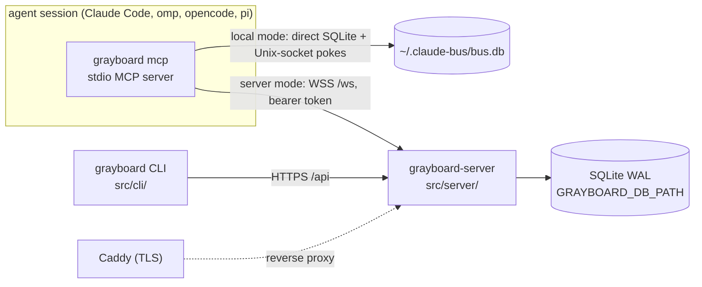

# Architecture

```doc-meta
owns: process model and mode selection; the distributed server (auth and sessions, WS protocol, HTTP access rules, server access policy, build and deploy)
invariants: one CLI entry picks local or server mode from the credentials file's existence; WS auth lives only on the upgrade (HTTP authenticates per request); Google tokens are never stored; sessions never expire; cursors advance only on ack; one push owner per identity (N tool lanes: probe a lane's holder, then refuse or supersede); hidden teams and boards read as not found; Repo is the Postgres seam
code-pointers: src/cli/main.ts (mcp, setup), src/cli/api.ts (busMode, credentials), src/server/, src/plugin/, src/shared/protocol.ts, src/shared/identity.ts, deploy/
companions: boards.md (core semantics both modes share), slack-bridge.md (the local bridge, a client of grayboard mcp; the org bridge, in-process in the server), ../AGENTS.md (release runbook), ../README.md (operator steps)
```

## 1. Process model



- One CLI binary is every client entry point. `grayboard mcp` loads `src/plugin/mcp.ts` (server mode) or `src/local/mcp.ts` (local mode); `grayboard-server` is the second binary.
- **Mode selection** (`busMode`, `src/cli/api.ts`): server mode if `GRAYBOARD_TOKEN` is set or the credentials file exists, else local. `--mode local|server` overrides, e.g. per repo in `.mcp.json`. An *empty* credentials file means signed out: server mode fails with "signed out" rather than silently becoming local (why logout truncates instead of deleting).
- **Local mode is a peer, not a fallback.** Same-machine live push needs no managed server process; Unix sockets are the right primitive. It is excluded from the server's migration seam (§7).
- Identity: `BUS_IDENTITY`, else a pin in the repo's `.mcp.json`, else the git repo's directory name, plus a worktree suffix (`src/shared/identity.ts`). See `boards.md` §3.

## 2. Server data

- One SQLite file, WAL. Schema is idempotent DDL at open (`src/server/db.ts:initSchema`; board tables from `src/core/schema.ts`). No migration tool; changes are additive.
- `messages` stores canonical address strings (`email/name`), not identity FKs.
- **Cursors are per identity**, not per user: each identity advances independently in its DM stream and, via core subscriptions, per board.
- `users.disabled_at` is enforced at auth: a disabled user's tokens fail `verifySessionToken` (`admin disable-user`). `teams.policy` is an unused seam: teams are invite-only regardless.
- Retention (`src/server/retention.ts`): messages, posts and audit rows age out (default 90 days). Pruning clears replies' `parent_id` first, or the FK breaks when a replied-to row ages out. Claims are never pruned, so retention can't swallow an expiry announcement; their history (`claim_events`) is, with posts. Nothing reclaims free pages: the monthly vacuum hook is empty, and `auto_vacuum=INCREMENTAL` only tracks free pages until something runs `PRAGMA incremental_vacuum` (not exposed through `Repo`).

## 3. Auth and sessions

- **Two layers, kept separate.** Google OIDC proves the human once, at login. Server-issued opaque tokens prove every later call. Google tokens are verified and discarded, never stored.
- Login (`src/cli/oauth_flow.ts` → `src/server/auth.ts:exchangeGoogleCode`): PKCE over a loopback redirect. The CLI bootstraps client ID and org domain from public `GET /api/auth/config`, so developers need no OAuth config. **The client secret never leaves the server**; the code exchange is server-to-server. The `id_token` must have `hd == GRAYBOARD_ORG_DOMAIN` and `email_verified`. Login (and dev login) refuses an email no direct address can carry (`isValidEmail`, `src/shared/addressing.ts`; e.g. an apostrophe), since that user could sign in but never be addressed (#72).
- Tokens: `gbrd_v1_<base64url(32 bytes)>`; only the SHA-256 is stored; the raw token is returned once. CLI writes `~/.grayboard/credentials` (0600).
- **Sessions never expire.** A long-running agent must not fail mid-task. Rotation is logout or admin revocation. Logout doesn't sweep open WebSockets; reconnect then fails auth. Admin `revoke-session` and `disable-user` do: they close the user's client connections with `unauthenticated` (`disconnectUser`, `src/server/ws.ts`). Only disable and enable move the Slack bridge's human (`SlackBridge.userChanged`); its in-process connection holds no token, so revoke leaves it. Each heartbeat closes a disabled user's connection that a concurrent hello slipped past.
- The plugin re-reads the credentials file on each reconnect, so after `grayboard login` a running session recovers by itself.
- Dev auth (`GRAYBOARD_DEV_AUTH=1`) mints sessions for any addressable email without Google. The server refuses to start if it's set together with `GOOGLE_OAUTH_CLIENT_SECRET` (`src/server/config.ts`), so a production config can't have it on.
- Config: derive from `src/server/config.ts` (fail-fast on missing required vars). `GRAYBOARD_ADMINS` empty means nobody is an admin.

## 4. WS protocol

Frames: derive from `src/shared/protocol.ts` (validated by hand in `parseClientMessage`). Handlers: `src/server/ws.ts`.

- **Auth is on the upgrade only.** `Authorization: Bearer` is checked in `Bun.serve.fetch` before `server.upgrade`; frames carry no credentials.
- **Hello** lowercases and validates the name, lazily creates the identity (audited `{lazy: true}`), and subscribes a new identity to its user's team boards in digest mode. `hello_ok` carries the user's teams and `notices` (this identity's DMs undelivered after 24h; active claims last, as the longest), which the plugin appends to the end of its MCP instructions so a client cut takes them, not fixed text. The board drain after hello includes deferred pushes and digests (`boards.md` §5); later drains on `wake` don't.
- **Lanes: one push owner per identity, N tool lanes.** Hello carries an optional `lane` key (default `main`). The server pings the holder of that lane key and waits 2s: answered → the newcomer gets `identity_in_use` and is closed; silent → the old one gets `superseded` and the newcomer takes the lane. A live push owner on ANOTHER lane demotes the newcomer to a tools-only lane (`push_granted: false`, `owner_lane` in hello_ok; takeover is refused) — first in line when the owner ends, when the close handler rotates the slot to the oldest live push-capable lane, synchronously (zero owners exists only inside that handler). A second hello during a probe waits for it, then re-checks the holders from the top, as the prober does after its probe: any await can change the holders, and nothing awaits between the last check and the writes (#69). Why: takeover lets a stray session steal live deliveries; the probe keeps a restarted session from being locked out by a dead socket. Lane rows mirror live sessions and are wiped at boot. `GET /api/fleet` lists them; `POST /api/fleet/disconnect` (the identity's own user, audited) closes a lane's connections superseded-style — never a human handle's.
- **The name `human` is reserved** for the Slack bridge's in-process connections (`src/server/slack.ts`); `hello` refuses it from a client WebSocket, so `<email>/human` is provably that user's person. `hello_ok.human` tells the plugin its user's human handle and whether it's linked (`slack-bridge.md` §8).
- `push: false` (from `BUS_PUSH=off`): a tools-only connection beside the identity's owner, claiming no lane key. Never pushed to, not in the registry, not "online". Demoted push lanes are tools-only too, but hold their lane key and rotate in. `resume: true` (reconnect within one session) keeps the lane's `peer_status`.
- **Drain on hello**: DMs after the lane's own cursor (`stream_ref` `handle` for `main`, `handle#lane` otherwise; a fresh non-main lane seeds from main's so joining doesn't replay history; any lane's ack counts as the identity reading, and no lane's ack can suppress another's pending), then pending board items for the owner only — boards have exactly one delivery and ack writer; a demoted lane catches up on boards when rotated in. Drain doesn't advance cursors; only `ack` does (`MAX(existing, new)`, so out-of-order acks can't regress). Board items: the connection keeps an in-flight set; `board_ack` acks in the core. A new connection starts empty, so unacked items resend. At-least-once for both. `send_ok` carries `live_lanes` (the recipient's live session count) and `read_lanes` (which lanes have acked this message).
- **DM send**: body non-blank and ≤ 64 KiB (`dmBody`, `src/shared/inbox.ts`, shared with local mode). A bare name resolves to the sender's own identity of that name, else the unique identity with it; ambiguity is `not_found` naming the candidates. `team:<name>` recipients are rejected: teams are reached by posting to their board. `history`'s peer resolves the same way (`resolvePeer`). `parent_id` must be a message the sender sent or received. `canSend` (§5) gates every DM. `send_ok` echoes `pending` because `parseClientMessage` passes unknown fields through: an older server ignores `pending` and the promise would be lost silently, so the plugin warns when the echo is missing.
- `call {tool, args}` runs the shared core dispatch (`src/core/tools.ts`) as the connection's identity; `CoreError` becomes `bad_request`. The returned wake list is pushed to connected handles immediately.
- Handlers after hello are synchronous and run inside one try/catch: a throw answers the frame's `req_id` with `internal` and keeps the socket, instead of leaving the client to its request timeout (§6).
- Heartbeat: server pings every 30s; `idleTimeout: 75` (`src/server/app.ts`). The connection registry is per process; after a restart clients reconnect and re-drain from durable cursors.

## 5. Access and authorization

- **`canSend`** (`src/server/can_send.ts`) is the policy seam for DMs: pure, synchronous, takes a pre-resolved principal and tagged target, returns `{allow}` or `{allow:false, code, reason}`. Its one rule today: another user's `human` identity is reachable only by teammates' agents (`reachesHuman`, `GRAYBOARD_SLACK_REACH`; `slack-bridge.md` §8). The one call site is the DM path in `ws.ts`.
- **`canAdmin`**: only emails in `GRAYBOARD_ADMINS`. Gates every `/api/admin/*` route, and team member management when the caller isn't a member.
- **Board access is enforced in the core**, through the `Access` policy the server installs at open (`src/server/access.ts`). `scope NULL`: anyone signed in. `scope team:<name>`: members only, for list, read, post, subscribe, mentions and pushes. A board you can't see reads as "no such board". Queued items for a handle that lost access are dropped at delivery.
- **Teams** (`src/server/teams.ts`, routes in `src/server/http.ts`): a team is an access group whose board is `#<team>`. Invite-only: any member or admin adds or removes by email; anyone can leave. Add requires the person to have signed in once (a user row). Add subscribes all their identities in digest mode; remove unsubscribes. Team and board names share one namespace.
- **Non-members get 404, not 403**, for a team's member routes and roster, so a private team's existence doesn't leak. Admins acting on a team they're not in are audited with `as_admin: true` (the path for an empty team). `POST /api/teams/:name/join` is always 403, kept so older CLIs get a pointer to `team add`.
- Distributed mentions: `@email/name` exact; `@local/name` by email local part; `@name` means the poster's own identity first, then a unique match among board viewers that `reachesHuman` allows; a bare `@human` is only ever your own (`slack-bridge.md` §8). Anything unresolved, ambiguous, or unable to see the board isn't pushed and returns in `unresolved`.
- Claims are org-wide: key, holder and note are visible to anyone signed in; `claim_list` hides the board name of an announcement on a board you can't see. `GET /api/claims` (for `grayboard claims`) authenticates a user, not a handle, so it omits board names entirely.
- `POST /api/claims/call` (for `grayboard claim`) runs a claim tool as one of the caller's own identities and passes the core's wake list to the same `wake` the WS tool path uses, so a CLI claim change is delivered like a tool call's. It refuses an identity the user doesn't have (`unknown_identity`, 404) instead of creating it lazily as hello does, so a mistyped name in a script can't hold claims, and refuses `human` (claims are for agents).

## 6. Plugin (`src/plugin/`)

- Waits at most 10s for `hello_ok` before the MCP handshake, and exits with the reason on refusal or no answer, so `/mcp` shows an error instead of hitting Claude Code's own 30s startup timeout. The MCP server is built after `hello_ok`, so its instructions include the notices.
- Holds pushes until Claude Code sends `initialized` (earlier notifications are dropped by Claude Code) and acks only after sending.
- Push format: `notifications/claude/channel` with `{content: body, meta}`; Claude Code renders the `<channel source="grayboard" …>` tag from `meta`.
- Every request settles by `req_id`, so the server answers a frame it can't parse with the frame's `req_id` when it has one; a 30s client timeout (`REQUEST_TIMEOUT_MS`) backstops any answer that still never names it (#40).
- `identity_in_use`, or a `bad_request` answering the hello itself (a reserved or invalid name), fails startup with the server's message (or exits on reconnect); `superseded` exits. None of these retries. Otherwise reconnect with backoff 1s → 30s cap.

## 7. Postgres seam

`Repo` (`src/server/db.ts`) is the only server-side store interface. Porting means reimplementing `Repo` and `src/core/` against Postgres and re-encoding the DDL. `src/server/db.test.ts` enforces that nothing else in the server tree imports `bun:sqlite`. `src/local/` and `src/bridge/` stay on SQLite and are excluded.

## 8. Build and deploy

- `bun build --compile` produces self-contained binaries (Bun runtime bundled). Every target cross-compiles on Linux runners (no macOS runner); a native dependency that can't cross-compile would break that. Release process: `AGENTS.md` §Releasing.
- `deploy/grayboard.service` runs `/usr/local/bin/grayboard-server` with `EnvironmentFile=/etc/grayboard/env`. `deploy/Caddyfile` terminates TLS for one host (placeholder `grayboard.example.com`); WS upgrade passes through.
- `deploy/backup.sh`: `sqlite3 .backup` to S3. Retention is an S3 lifecycle rule, not the script.
- Operator steps (host, DNS, OAuth client, env file, updates): `README.md` §Distributed mode.
