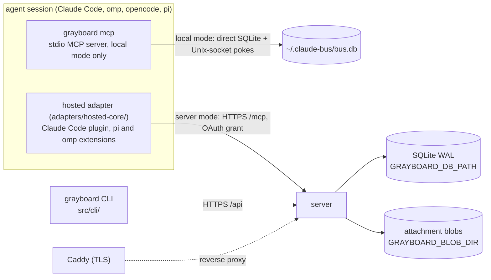

# Architecture

```doc-meta
owns: process model and mode selection; the distributed server's data, auth layers and tokens, and Postgres seam
invariants: the CLI's commands pick local or server mode from the credentials file's existence, while `grayboard mcp` is local only; a server runs with no mandatory outside service beyond the org's identity provider; HTTP authenticates per request; Google tokens are never stored; a CLI token expires only by idleness; Repo is the Postgres seam and its BlobStore the object-store seam
code-pointers: src/cli/main.ts (entry; Claude Code hook shim), src/cli/cli.ts (mcp, setup), src/cli/api.ts (busMode, credentials), src/local/launch.ts, src/shared/toolguard.ts (signedInLocalNotice), src/server/db.ts, src/server/auth.ts, src/server/idp.ts, src/server/idp_google.ts, src/server/config.ts, src/server/retention.ts, src/shared/http.ts
companions: boards.md (core semantics both modes share); server-oauth.md, server-hosted-mcp.md, server-hosted-ownership.md, server-sessions.md, server-operations.md, server-access.md, server-deploy.md (the server's other parts); slack-bridge.md (the local bridge, a client of grayboard mcp), slack-org-bridge.md (the org bridge, in-process in the server); guide/server.md (operator steps)
```

## 1. Process model



- The CLI binary's `grayboard mcp` is the local-mode stdio entry (`src/local/mcp.ts`); `--mode server` is refused with `UPGRADE_REFUSAL` (#282). Hosted OpenCode V2 connects directly through native HTTP MCP and an in-process delivery supplement, without a Grayboard executable or subprocess. So do the hosted adapters in server mode: Claude Code's plugin (`plugins/claude-code/`, a stdio MCP server Claude Code runs under Bun) and pi's and omp's extensions run hosted-core in a process the harness starts. `grayboard-server` is the second binary.
- **Mode selection** (`busMode`, `src/cli/api.ts`) is for the CLI's commands: server mode (HTTP, `src/cli/api.ts`) if `GRAYBOARD_TOKEN` is set or the credentials file exists, else local. `grayboard mcp` ignores it for the choice and is local unconditionally, so a signed-in user's local entries keep working; it accepts only `--mode local`. On a signed-in machine it audits `id.signed_in_local {server, mode_pinned}` (the server URL's origin only), and an entry without `--mode local` leads its instructions with `signedInLocalNotice` and logs it to stderr (#491). An *empty* credentials file means signed out: a server-mode command fails with "signed out" rather than silently becoming local (why logout truncates instead of deleting).
- **Local mode is a peer, not a fallback.** Same-machine live push needs no managed server process; Unix sockets are the right primitive. It is excluded from the server's migration seam (§4).
- Identity: a session binds at start only an explicit `BUS_IDENTITY` (one that differs from every repo pin; no worktree suffix, lowercased and validated as at bind, #181; on a server it may carry a scope, `eng/build`, which the server judges at bind); otherwise it starts unbound and binds with `bind` (#182). The pin, else the repo directory name, plus a worktree suffix, is only the first candidate (`src/shared/identity.ts`). See `handles.md`.

## 2. Server data

- One SQLite file, WAL. Schema is idempotent DDL at open (`src/server/db.ts:initSchema`; board tables from `src/core/schema.ts`). No migration tool; changes are additive.
- Attachment bytes live outside the DB, in the `BlobStore` on `Repo` (`repo.blobs`): server `DiskBlobs` (`src/server/blobs.ts`), one file per SHA-256 under `GRAYBOARD_BLOB_DIR` (default `blobs/` beside the DB), written temp-then-rename so a reader sees all the bytes or none. Put and sweep ordering: `attachments.md`.
- `messages` stores address strings (`scope/name`, or `id:…` for a session acting as its ID), not identity FKs; `sender_id` is the writing session (null for the Slack bridge's humans), `via` the child session that wrote it under its root's addresses (null for a root's own write; shown to readers, unlike `sender_id`; `child-sessions.md`), and `kind` marks a bounce (`sessions.md`). A hosted child's root lives on its `ids` row (`ids.root_id`, set by `hostedRoot`, `src/server/application.ts`), not only its `hosted_sessions` row, which is deleted when the child ends: a send or mention to the child's ID must stay refused `child_session` after that. `recordChildRoots` (`src/server/db.ts`) backfills it at open from live child rows an older release registered.
- `write_receipts` (#254) holds each deduplicated write's result for the dedup window (`server-operations.md`): keyed `(session, sender, fp)`, the row it made (`ref_kind`, `ref_id`) and `result_json`, the first call's result. It carries no body, but a `dm_send` or `board_post` result's attachment metadata (`AttachmentInfo`: id, filename, type, size, sha256) stays until the receipt is pruned: on each write for that session, and nightly for all.
- **Cursors are per address**, not per user: each alias and each session ID advances independently in its DM stream and, via core subscriptions, per board.
- `users.disabled_at` is enforced at auth: a disabled user's tokens fail `verifySessionToken` (`admin disable-user`). An admin disable (`setDisabled`) also revokes the user's CLI tokens, so `enable-user` doesn't revive them (a disable written straight into the database revokes nothing), and CLI sign-in refuses a disabled user with 403 (`auth.user_refused`), as OAuth consent does (`oauth.user_refused`). `teams.policy` is an unused seam: teams are invite-only regardless.
- **Audit rows say where a request came from** (security audit F-19, [#806](https://github.com/nolnoch/grayboard/issues/806)): every `access_log` row goes in through `insertAudit` (`src/server/db.ts`), which stamps `ip` (the client address after trusted-proxy resolution, `client_addr.ts`, never a raw `X-Forwarded-For`) and `ua` (the user agent, at most 120 characters) of the HTTP request whose handling wrote it. `app.ts` runs each request inside `inRequest` (`src/server/request_context.ts`, an `AsyncLocalStorage`), so the origin follows the request through awaits and the timers it arms; the claim-expiry timer, which fires for every holder, is armed `detached`. The origin is the request's, not the actor's: a row about Bob's session written while handling Alice's request carries Alice's address. Work no request caused (boot, retention, the timer-driven hosted sweeps, the Slack bridge's socket and its relay to Slack, armed `detached` too) writes null; the at-capacity sweep runs inside the admitting request and carries its address, as do rows from before the columns. The address is personal data and ages out with the row (90 days by default). Local mode's `audit_log` is unchanged.
- Retention (`src/server/retention.ts`): messages, posts and audit rows age out (default 90 days). Pruning clears replies' `parent_id` first, or the FK breaks when a replied-to row ages out. Claims are never pruned, so retention can't swallow an expiry announcement; their history (`claim_events`) is, with posts. Ended sessions' `ids` rows go on the message window too (`pruneEndedIds`, both modes' rule, `attachments.md`). Attachments go with their message or post; unsent uploads are pruned nightly and on each upload (`attachments.md`); blobs no row names are swept (`sweepBlobs`) whenever rows drop (a retract, a release, a failed put) and by the nightly run, which finishes any sweep a crash left. Then it returns free pages to the filesystem (`Repo.storage.reclaimFreePages`, `PRAGMA incremental_vacuum`, at most `RECLAIM_PAGES_PER_RUN` = 16,384 per night so one run is bounded; #137). That needs `auto_vacuum=INCREMENTAL`, which a database created since #170 has; older ones have `auto_vacuum=NONE` (the pragma ran after the WAL switch, too late to apply), reclaim nothing, and log so nightly while they have free pages, until a one-time `VACUUM` converts them (`guide/server.md` §Reclaiming disk space). Local mode does the same after its daily run (`src/local/retention.ts`, the shared `reclaimFreePages` in `src/core/sqlite.ts`; #148): a bus created after v2.4.2 is incremental (`openLocalDb` and `writeRetentionSetting` both set it before the first page write), an older one logs the same hint, pointing at `guide/local.md` §Reclaiming disk space.

## 3. Auth and sessions

- **No mandatory SaaS.** An operator self-hosts with only the org's identity provider (Google) as an outside dependency. Auth that needs a hosted tenant (an external authorization server for the hosted MCP path) is refused for that reason, and because a delegated JWT can't be revoked at once the way a server-held grant can (#204 decision; #142). Keeping grants in the server's DB also keeps their audit trail with the operator.
- **Two layers, kept separate.** Google OIDC proves the human once, at login. Server-issued opaque tokens prove every later call. Google tokens are verified and discarded, never stored.
- Login (`src/cli/oauth_flow.ts` → `src/server/idp_google.ts:exchangeGoogleCliCode`): PKCE over a loopback redirect. The CLI bootstraps client ID and org domain from public `GET /api/auth/config`, so developers need no OAuth config. **The client secret never leaves the server**; the code exchange is server-to-server. The `id_token` must have `hd == GRAYBOARD_ORG_DOMAIN` and `email_verified`. Login (and dev login) refuses an email no direct address can carry (`isValidEmail`, `src/shared/addressing.ts`; e.g. an apostrophe), since that user could sign in but never be addressed (#72). A Google sign-in, on the CLI's exchange and on the OAuth AS's callback, resolves its user through `googleSignIn` (`src/server/auth.ts`, over `repo.users.signIn`) by the ID token's `sub` first (`users.idp_subject`, unique where set; security audit F-13, #806): an email Google hands to a new account would otherwise inherit the old account's aliases, mail, history and teams. A user with no subject yet (from before the column, or made by dev login) takes the first one that signs in with its email (`auth.subject_linked`). An email whose user holds another subject is refused 403 (`auth.subject_refused {reason: subject_mismatch}`), and so is a known subject reporting another email (`email_changed`), since users are keyed by email and a rename would move every address; neither creates or changes a user. `grayboard admin unlink-idp --email <e>` (`/api/admin/unlink-idp`, `auth.subject_cleared {had_subject}`) clears the subject so the next sign-in with the email takes the account: for a person whose Google account was recreated, or a deliberate hand-over.
- Tokens: `gbrd_v1_<base64url(32 bytes)>`; only the SHA-256 is stored; the raw token is returned once. CLI writes `~/.grayboard/credentials` (0600, re-applied on every write since a create mode doesn't reach an existing file; a read of a file other users can read warns on stderr, #88). `logout` truncates the file even when it's corrupt or names no server, skipping the server call (#87).
- **CLI tokens expire by idleness, not age.** A token unused for `GRAYBOARD_CLI_TOKEN_IDLE_DAYS` (default 30; 0 never) is refused (`verifySessionToken`, #806), so a forgotten credentials file dies on its own while a long-running agent that keeps using its token never fails mid-task. Otherwise rotation is logout or admin revocation. Logout only revokes that token (`auth.logout`, `token_session`); it closes nothing, since no connection holds a token any more (#282). Admin `revoke-session` and `disable-user` close the user's live application sessions with `unauthenticated` (`disconnectUser`, `src/server/application.ts`, `server-sessions.md`); the revoke or disable transaction itself ends the user's hosted ownerships (`endHostedWhere`, `src/server/db.ts`). Only disable and enable move the Slack bridge's human (`SlackBridge.userChanged`); its in-process connection holds no token, so revoke leaves it. A 30s `revalidate` timer (`src/server/app.ts`) is the backstop for a disable made directly in the database, closing that user's sessions.
- Dev auth (`GRAYBOARD_DEV_AUTH=1`) mints sessions for any addressable email without Google. The server refuses to start if it's set together with `GOOGLE_OAUTH_CLIENT_SECRET` or `GRAYBOARD_MCP_GOOGLE_CLIENT_SECRET` (`src/server/config.ts`), so a production config can't have it on, and refuses it unless `GRAYBOARD_PUBLIC_URL` is loopback. Dev sign-in answers only a client on the server's own host (its resolved address is loopback; `src/server/client_addr.ts`): the server listens on every interface and a proxy forwards to it, so a loopback URL alone doesn't keep a remote client out. A refusal is a 403, audited `auth.dev_login_refused`. A server started without it revokes every dev-minted session (label `dev`) and audits `auth.dev_sessions_revoked`, so no dev token outlives dev auth, even if it's turned back on (#805 F-04, `src/server/app.ts`).
- Config: derive from `src/server/config.ts` (fail-fast on missing required vars). `GRAYBOARD_ADMINS` empty means nobody is an admin.

## 4. Postgres seam

`Repo` (`src/server/db.ts`) is the only server-side store interface. Porting means reimplementing `Repo` and `src/core/` against Postgres and re-encoding the DDL. Core `endSession` reaches the server's mail only through `Repo.mail` (core's `MailPort`), and access asks `Repo.resolver` (core's `Resolver`) for principals, so a port reimplements those two interfaces rather than their callers. Attachment bytes sit behind `Repo`'s async `BlobStore` (`src/core/attachments.ts`), so moving them to an object store means another `BlobStore`, not a change to callers. `src/server/db.test.ts` enforces that nothing else in the server tree imports `bun:sqlite`. `src/local/` and `src/bridge/` stay on SQLite and are excluded. Stage 3 replaces this seam: the server gets its own async store, and `src/core/` loses its server callers ([future/postgres-server.md](future/postgres-server.md)).

The per-request authorization reads (`Repo`'s `oauth.findActiveAccess`, `users.isDisabled` and `users.activeEmail`) are cached inside `Repo` on an authorization generation (`authGeneration`, `makeRepo`, #853), under the store methods so a test that replaces one replaces its cache: TEMP triggers on `oauth_tokens`, `oauth_grants` and `users` bump a connection-local counter, paired with `data_version` so a write through another connection or process also clears the cache; inside a transaction the generation is undefined (the counter rolls back with it) and the cache is bypassed. `Repo.authRead(fn)` reads the generation once for `fn`'s synchronous body, so one authorization's token and user reads share it (`activeAccess`, `src/server/oauth.ts`; `authorize`'s grant and disabled-user checks in `src/server/mcp.ts`, #902); `fn` must not write `oauth_tokens`, `oauth_grants` or `users`, or its later reads would trust a stale generation. A port has no `data_version`: it needs the generation in shared storage (a row or `LISTEN/NOTIFY`), or a revocation written by another server instance never clears this one's cache. `Repo.authGeneration()` exposes the generation (authRead's pinned one inside its body): the hosted MCP stream timer stamps each open stream with it (#899), so the same port needs the shared generation there too; and on that port another instance's `hosted_sessions` or `alias_holds` commits, which move no generation and send no in-process notice, reach an open stream only through the stream timer's backstops (`docs/server-hosted-mcp.md` §1).
