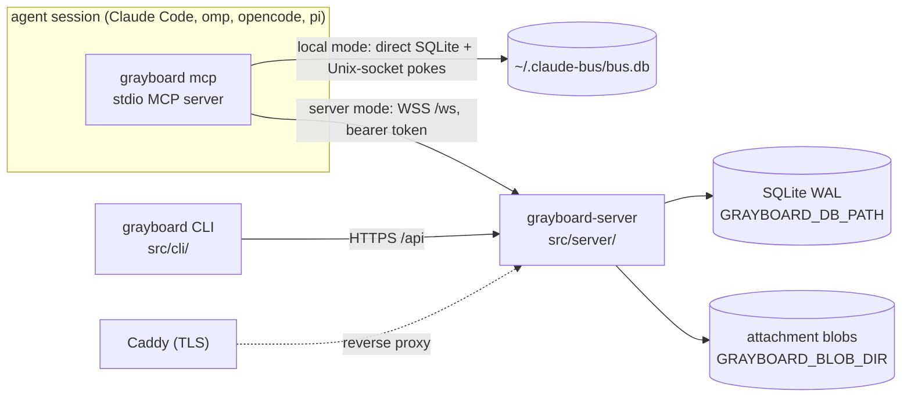

# Architecture

```doc-meta
owns: process model and mode selection; the distributed server (auth and sessions, WS protocol, HTTP access rules, server access policy, build and deploy)
invariants: one CLI entry picks local or server mode from the credentials file's existence; a server runs with no mandatory outside service beyond the org's identity provider; WS auth lives only on the upgrade (HTTP authenticates per request); Google tokens are never stored; sessions never expire; cursors advance only on ack; one live connection per session ID (probe: answered is id_collision, silent is superseded); a session outlives its connection by a grace and ends only through endSession; another session's alias hold, live or in its grace, is never taken over; who may act in a scope is one principal-keyed check (mayActIn), re-checked for the life of a hold; an unkeyed client whose session ended re-keys and proves descent with the old key, a keyed one exits; hidden teams and boards read as not found; Repo is the Postgres seam and its BlobStore the object-store seam; a backup is the DB snapshot plus the blob directory; attachment bytes cross HTTP, never WS frames, and bind to a message or post only by id; authentication failures are limited per client address and charged only on a refused presented token or a sign-in call, so valid traffic never touches a bucket; a binary is installed or replaced only after a compiled-in or script-embedded key verifies the release's SHA256SUMS, its tag line equals the tag fetched, and the binary matches both that file and the API digest; the trusted key list has no runtime override
code-pointers: src/cli/main.ts (mcp, setup), src/cli/api.ts (busMode, credentials), src/server/, src/plugin/, src/core/resolver.ts, src/core/session_end.ts, src/shared/protocol.ts, src/shared/identity.ts, src/shared/http.ts, deploy/, install.sh (server restart, release verification), src/cli/update.ts, src/shared/release_verify.ts, src/shared/release_keys.ts, scripts/release_keys.ts, scripts/build_scratch.sh
companions: boards.md (core semantics both modes share), slack-bridge.md (the local bridge, a client of grayboard mcp; the org bridge, in-process in the server), ../AGENTS.md (release runbook), ../README.md (operator steps)
```

## 1. Process model



- One CLI binary is every client entry point. `grayboard mcp` loads `src/plugin/mcp.ts` (server mode) or `src/local/mcp.ts` (local mode); `grayboard-server` is the second binary.
- **Mode selection** (`busMode`, `src/cli/api.ts`): server mode if `GRAYBOARD_TOKEN` is set or the credentials file exists, else local. `--mode local|server` overrides, e.g. per repo in `.mcp.json`. An *empty* credentials file means signed out: server mode fails with "signed out" rather than silently becoming local (why logout truncates instead of deleting).
- **Local mode is a peer, not a fallback.** Same-machine live push needs no managed server process; Unix sockets are the right primitive. It is excluded from the server's migration seam (§7).
- Identity: a session binds at start only an explicit `BUS_IDENTITY` (one that differs from every repo pin; no worktree suffix, lowercased and validated as at bind, #181; on a server it may carry a scope, `eng/build`, which the server judges at bind); otherwise it starts unbound and binds with `bind` (#182). The pin, else the repo directory name, plus a worktree suffix, is only the first candidate (`src/shared/identity.ts`). See `boards.md` §3.

## 2. Server data

- One SQLite file, WAL. Schema is idempotent DDL at open (`src/server/db.ts:initSchema`; board tables from `src/core/schema.ts`). No migration tool; changes are additive.
- Attachment bytes live outside the DB, in the `BlobStore` on `Repo` (`repo.blobs`): server `DiskBlobs` (`src/server/blobs.ts`), one file per SHA-256 under `GRAYBOARD_BLOB_DIR` (default `blobs/` beside the DB), written temp-then-rename so a reader sees all the bytes or none. Put and sweep ordering: `boards.md` §12.
- `messages` stores address strings (`scope/name`, or `id:…` for a session acting as its ID), not identity FKs; `sender_id` is the writing session (null for the Slack bridge's humans), and `kind` marks a bounce (`boards.md` §3).
- `write_receipts` (#254) holds each deduplicated write's result for the dedup window (§4): keyed `(session, sender, fp)`, the row it made (`ref_kind`, `ref_id`) and `result_json`, the first call's result without its frame. It carries no body, but a `dm_send` or `board_post` result's attachment metadata (`AttachmentInfo`: id, filename, type, size, sha256) stays until the receipt is pruned: on each write for that session, and nightly for all.
- **Cursors are per address**, not per user: each alias and each session ID advances independently in its DM stream and, via core subscriptions, per board.
- `users.disabled_at` is enforced at auth: a disabled user's tokens fail `verifySessionToken` (`admin disable-user`). `teams.policy` is an unused seam: teams are invite-only regardless.
- Retention (`src/server/retention.ts`): messages, posts and audit rows age out (default 90 days). Pruning clears replies' `parent_id` first, or the FK breaks when a replied-to row ages out. Claims are never pruned, so retention can't swallow an expiry announcement; their history (`claim_events`) is, with posts. Ended sessions' `ids` rows go on the message window too (`pruneEndedIds`, both modes' rule, `boards.md` §12). Attachments go with their message or post; unsent uploads are pruned nightly and on each upload (`boards.md` §12); blobs no row names are swept (`sweepBlobs`) whenever rows drop (a retract, a release, a failed put) and by the nightly run, which finishes any sweep a crash left. Nothing reclaims free DB pages (#137): the monthly vacuum hook is empty. A database created since #170 has `auto_vacuum=INCREMENTAL`, which only tracks free pages until something runs `PRAGMA incremental_vacuum` (not exposed through `Repo`); older ones have `auto_vacuum=NONE` (the pragma ran after the WAL switch, too late to apply) until a one-time `VACUUM` converts them.

## 3. Auth and sessions

- **No mandatory SaaS.** An operator self-hosts with only the org's identity provider (Google) as an outside dependency. Auth that needs a hosted tenant (an external authorization server for the hosted MCP path) is refused for that reason, and because a delegated JWT can't be revoked at once the way a server-held grant can (#204 decision; #142). Keeping grants in the server's DB also keeps their audit trail with the operator.
- **Two layers, kept separate.** Google OIDC proves the human once, at login. Server-issued opaque tokens prove every later call. Google tokens are verified and discarded, never stored.
- Login (`src/cli/oauth_flow.ts` → `src/server/auth.ts:exchangeGoogleCode`): PKCE over a loopback redirect. The CLI bootstraps client ID and org domain from public `GET /api/auth/config`, so developers need no OAuth config. **The client secret never leaves the server**; the code exchange is server-to-server. The `id_token` must have `hd == GRAYBOARD_ORG_DOMAIN` and `email_verified`. Login (and dev login) refuses an email no direct address can carry (`isValidEmail`, `src/shared/addressing.ts`; e.g. an apostrophe), since that user could sign in but never be addressed (#72).
- Tokens: `gbrd_v1_<base64url(32 bytes)>`; only the SHA-256 is stored; the raw token is returned once. CLI writes `~/.grayboard/credentials` (0600).
- **Sessions never expire.** A long-running agent must not fail mid-task. Rotation is logout or admin revocation. Logout doesn't sweep open WebSockets; reconnect then fails auth. Admin `revoke-session` and `disable-user` do: they close the user's client connections with `unauthenticated` and end all the user's unended bus sessions at once, not through the grace (`disconnectUser`, `src/server/ws.ts`, §4). Only disable and enable move the Slack bridge's human (`SlackBridge.userChanged`); its in-process connection holds no token, so revoke leaves it. Each heartbeat closes a disabled user's connection that a concurrent hello slipped past.
- The plugin re-reads the credentials file on each reconnect, so after `grayboard login` a running session recovers by itself.
- Dev auth (`GRAYBOARD_DEV_AUTH=1`) mints sessions for any addressable email without Google. The server refuses to start if it's set together with `GOOGLE_OAUTH_CLIENT_SECRET` (`src/server/config.ts`), so a production config can't have it on.
- Config: derive from `src/server/config.ts` (fail-fast on missing required vars). `GRAYBOARD_ADMINS` empty means nobody is an admin.

## 4. WS protocol

Frames: derive from `src/shared/protocol.ts` (validated by hand in `parseClientMessage`). Handlers: `src/server/ws.ts`.

- **Auth is on the upgrade only.** `Authorization: Bearer` is checked in `Bun.serve.fetch` before `server.upgrade`; frames carry no credentials.
- **The hello is the session** (#284). It must carry `proto: 2`: a 1.x hello fails parsing and gets `bad_request` saying to run `grayboard update`, since a 1.x client can't act as an ID (its named start exits on it; its unbound start keeps running with reads unavailable). It must carry `session_key`, a per-process secret; the server derives the `id:` session ID from it (`idAddress`), so no connection can present another session's ID, which `peer_list` and `alias_held` expose (#182 audit 4). The key's `ids` row decides: none → registered (`id.registered`; `keyed` when the key came from `BUS_SESSION_KEY`; a key whose pruned row left a tombstone is audited `id.reused`); another principal's, or ended → `id_collision`, audited; the caller's own, unended → re-attached with its holds and status (`id.reattached`; `resume` is detail only, since holding the key is the proof). The hello names no alias: an unbound session is a full participant acting as its ID, and aliases come by `bind`. `hello_ok` carries `id`; `bound` when a re-attached session already holds an alias (the client then binds nothing at start, so a keyed restart with `BUS_IDENTITY` doesn't rebind away from an alias the agent moved to); the user's teams; and `notices` (the launcher instruction; an owed Slack-bridge death notice, `slack-bridge.md` §8, before the claims since it drains once; the session's DMs undelivered after 24h; active claims last, as the longest), which the plugin appends to the end of its MCP instructions so a client cut takes them, not fixed text. It also carries `attachment_limits`, so the plugin refuses an oversized file before uploading anything. The plugin reads them from the live connection's `hello_ok` on each use, so a reconnect to a reconfigured server takes effect; a `hello_ok` without the field means a server from before attachments, and attachment tools refuse with "needs updating". The board drain after hello includes deferred pushes and digests (`boards.md` §5); later drains on `wake` don't.
- **Hellos are rate-limited per user** (#210, `RateLimiter`, `src/server/rate_limit.ts`): a token bucket per user (sizes: `src/server/config.ts`), spent by every hello and every `bind`, and checked before anything reads or writes the database. Over it, a hello gets `rate_limited` with `retry_after_ms` (the wait until a token is back) and is closed, leaving no `ids` or alias row; a bind gets the same refusal and keeps its socket. Why: a hello registers an `ids` row and a bind creates its alias lazily, so a client looping on either could load the server and mint rows without bound; lazy creation left the hello so that a bind loop is limited too. The Slack bridge's in-process connections are exempt. A run of refusals lasts until the user's bucket is full again, seen by the next hello or by the 30s limiter sweep (`sweepLimits`, `src/server/app.ts`, which drops refilled buckets); ending it at any accepted hello would let a loop just faster than the refill start a run, and an audit row, at every refusal. Each run logs one line and writes one audit row when it starts (`hello.rate_limited`, detail: the tripping frame's session ID, its place or the alias it bound, and `retry_after_ms`) and one of each with its count when it ends (`hello.rate_limit_ended`, detail `{refused}`).
- **Authentication failures are rate-limited per client address** (#240, `AuthGate`, `src/server/auth_gate.ts`, on the same `RateLimiter`): every presented token the server refuses with 401 and every call to a sign-in route (`signInRoute`, `src/server/http.ts`, one table that both dispatches and decides charging; charged on entry because the exchange awaits Google; a disabled route, such as dev-login with dev auth off, dispatches to 404 uncharged) spends a token from the address's bucket. The upgrade's invalid-token refusal is charged in `fetch` (`authGate.charge`); an HTTP 401 is charged on `handleHttp`'s response when the request carried a bearer token (`chargeRefusedToken`), so a protected or unknown path with a bad token costs one, while the public routes, dispatched before `requireAuth`, cost nothing unless they are sign-in routes. A request with no token costs nothing: a web page can make a browser send one cross-origin (an ``, a WebSocket), but can't attach `Authorization` without a CORS preflight, so charging them would let any page lock out everyone behind its viewer's NAT. For the same reason a sign-in route takes only `Content-Type: application/json` (`isJsonRequest`) and answers anything else 415 `unsupported_media_type`, uncharged: a cross-origin form post needs no preflight, a JSON one does. While it's empty, `fetch` answers every request from the address, `/healthz` included, with 429 `{code: "rate_limited", message, retry_after_ms}` and `Retry-After` (whole seconds, at least 1), before anything reads the database. 403s, 404s and the 429s themselves cost nothing, and valid authenticated traffic never touches a bucket: a check allocates nothing, so the map holds only addresses that have failed, dropped by the 30s sweep once refilled, and capped at 10,000 (past the cap a new address is neither charged nor refused, with a log line and an `auth.rate_limit_full` row at most once a minute; a flood spread across addresses belongs at the network edge). Why failures only: a lookup that succeeds is bounded by legitimate use and the hello limit, and charging only failures keeps a stale-token client behind a shared NAT from blocking its neighbours until it has failed the whole burst; the plugin stops retrying a refused token (§6), which keeps it from getting there. The address (`src/server/client_addr.ts`) is the peer, normalised (Bun reports an IPv4 peer as `::ffff:a.b.c.d`), or when the peer is in `GRAYBOARD_TRUSTED_PROXIES` (default loopback) the first untrusted `X-Forwarded-For` entry walking from the right, with a port or brackets stripped; a walk that runs out of entries, or meets one that doesn't parse, keys by the last address it trusted, and the first unparsable entry per process is logged, since it puts that proxy's clients in one bucket. A peer Bun can't report keys to the shared bucket `unknown`, never skipping the gate. IPv4 keys by address, IPv6 by /64. The resolved address is also `auth.login`'s `ip`. A run of refusals has the hello limit's streak semantics, with `auth.rate_limited` (actor null, target the key; its detail carries the refused request's full address and `last_failure`, the charge that emptied the bucket, so a stale-token fleet reads differently from a scan) and `auth.rate_limit_ended` (`{refused}`) rows and a log line each. The start hook runs before the refusal is counted, so a failed audit write leaves no run without its row; `sweepLimits` (its own 30s timer in `startServer`) runs both limiters' sweeps, each catching per bucket.
- **One live connection per session ID: probe, then refuse or supersede.** A hello whose ID has a connection pings it and waits 2s. Answered → `id_collision` (two processes on one key). Silent → the old connection is detached, gets `superseded` and is closed, and the newcomer re-attaches; detached first, so the old socket's later `close` finds another connection holding the ID and records no grace. A second hello during a probe waits for it, then re-checks from the top, as the prober does after its probe: any await can change the holder, and nothing awaits between the last check and the `holders` write (#69). Another principal's row is refused before anything touches the hub, so no hello can probe or supersede another user's connection.
- **Grace and end** (#284 S4). An agent connection's close, while it's still its ID's holder, keeps the session's holds and records a grace (`GRACE_MS`, audited `id.detached`): a network blip must not lose the alias. `sweepSessions` (its own `SWEEP_MS` timer) ends each ID past its grace through core `endSession` (`boards.md` §3: bounces, claim release, holds released) in its own transaction, with mail through `Repo.mail`, so the end lands 30–35s after the close; an ID with a live connection only leaves the grace, so a stale close can't end a session that came back. Bounces to live senders are pushed at once. An `end` frame (an unkeyed client's clean exit) ends the session at once and answers `end_ok`; any later frame on that socket gets `id_ended` and the socket closes. A keyed client never sends `end`: its orchestrator may restart it on the same key within the grace. At server start every unended ID gets a grace from the start, so a deploy ends only the sessions that don't come back, through `endSession` rather than a wipe.
- **The Slack bridge's humans** (`HumanConn`, `src/server/slack.ts`) hello in-process with no key: `ws.data.human` is set only there, so no network client reaches that path. A human gets no ID (`hello_ok.id` is `human`), no `ids` row, grace or end; it holds `<email>/human` (a newer bridge connection for the user supersedes it) and its writes carry no `sender_id`. With `human` refused in every `bind` and `writes_as`, `<email>/human` is provably that user's person. `hello_ok.human` tells the plugin its user's human handle and whether it's linked (`slack-bridge.md` §8).
- **`bind`** (`src/server/ws.ts` `handleBind`) takes an alias for the session or, while it holds one, moves to another: the old hold is released and the bind logs `moved`; claims stay with the alias they were taken under, and `bind_ok.left` lists them (`boards.md` §3). A bare name is the caller's own person scope; `scope/name` needs `mayActIn` (§5); `human` is refused in every scope, since `canSend` treats any `*/human` as a person's phone. The alias is created lazily (audited `{lazy: true, session}`) unless `create: false`, which refuses a never-seen name with `identity_unknown` carrying `known` (the closest names). An alias another session holds, live or in its grace, is `alias_held` naming the holder, its place and, for one in its grace, when it ends, with `retry_after_ms` covering the grace plus one sweep so a restore retries once it's free; there's no takeover. After `bind_ok` the server drains the alias's mail and boards.
- **Binding events** (`binding_events`, `boards.md` §3) come from `bind`, session end and revocation; a hello logs only a tools-only `writes_as` refusal: `bound` (detail `restored: restart of session <id>` for a verified `restored_from`, `restored after end of session <id>` for a verified `previous_key`, else the `… not verified` reason; only a verified one inherits the predecessor's status, #211. `restored_from` names a public ID, so it shows the history, not descent; `previous_key` is the ended session's secret, so it proves descent, #259), `moved` on a rebind, `refused` (a bind's, or a tools-only hello's `writes_as`; a retry loop's repeats share one row, `boards.md` §3), `released` on a rebind, a session end (`session_end: <why>`) or an access revocation. A close releases nothing: the grace keeps the hold. The Slack bridge's human logs under the literal session `human`.
- **Hold and tools-only connections are sessions** that are never pushed to and aren't in the registry or online. `hold: true` with `push: false` (a Claude Code session without channels) binds and holds an alias like a push session; its row has `delivery = 'push'`, as a local channels-off session (#71), so a send to its ID is accepted and waits for `dm_inbox`; why: holding nothing let two such sessions bind one name (#182 audit 2). `push: false` alone (`BUS_PUSH=off`) is tools-only: it names `writes_as`, judged like a bind target and created lazily but never held, and it reads and writes only as that alias (its address set is `[writes_as]`); its row has `delivery = 'none'`, so a send to its ID is refused, and its `bind` is refused.
- **Address set** (#284 S8): a session reads as {bound alias, ID} and writes as its primary (the alias while bound, else the ID); the registry is keyed by address. History, inbox and thread match any address in the set; an `ack` advances each message's own recipient address's cursor, a retract acts as the address that sent the message, and `board_ack` acknowledges on each address. **Drain on hello**: DMs after each address's cursor (`mailbox_cursors`, keyed by address; seeded once from 1.x `cursors`, as `aliases` is from 1.x `identities`, and neither old table is read after), then pending board items; a re-attach drains the alias too, so mail sent during a grace arrives on resume. Drain doesn't advance cursors; only `ack` does (`MAX(existing, new)`, so out-of-order acks can't regress). Board items: the connection keeps an in-flight set; `board_ack` acks in the core. A new connection starts empty, so unacked items resend. At-least-once for both.
- **Delegation** (`delegate {persona, task, context?, to?}`, #184): the server resolves the target — `to` through the same resolution as `send`'s recipient (`resolvePeerInput`), then both modes of targeting (explicit and auto-pick) restricted to the requester's own user — and delivers the payload as a pending DM through the ordinary send path. The payload fences persona/task/context inside a four-backtick JSON block the launcher's instruction says is data; the body's header is never authority (the DM's sender is, and it must be the launcher's own user). Every outcome is audited: `delegation.requested` (target: the launcher; detail `{requester, via: explicit|auto|human_fallback, message_id}`) or `delegation.refused {reason}`; `handle.launcher_set {on}` against the session ID on every push hello, whether or not the flag changed (locally, once per session that owns delivery, under its ID). The reply is `send_ok` with `to` and, on the degrade path, `human_fallback` added (`DelegateOk`). A hold or tools-only connection is never a launcher: its flag is ignored and no instruction is sent. `hello` carries `launcher?: true` — the session's harness can spawn subagents, so delegate requests may land there; recorded on the session's `ids` row only from a push hello.
- **DM send**: body non-blank and ≤ 64 KiB (`dmBody`, `src/shared/inbox.ts`, shared with local mode). A bare name resolves to the acting address's own scope's alias of that name (`ownScope`: an alias's scope, or an ID's principal), else the one alias anyone has with it; ambiguity is `not_found` naming the candidates (`resolvePeerInput`). A send to an `id:` is checked inside the write's transaction (`assertDeliverableId`), so it can't race that session's end: an ended or tools-only ID is refused, never queued: core's `Undeliverable` carries `not_found`, `id_ended` or `no_delivery`, which `coreRefusal` sends as the error frame's code (the same code and text local mode shows), as it does for an `@id:` mention a post is refused for. `team:<name>` recipients are rejected: teams are reached by posting to their board. `history`'s peer resolves the same way (`resolvePeer`). `parent_id` must be a message the sender sent or received. DM visibility is one check, `participant` (`src/server/db.ts`), shared by send's parent check, `thread`, and attachment reads; a DM you're not in reads as missing. `canSend` (§5) gates every DM. `attachment_ids` names uploads (§5 Attachments) to bind in the message's transaction. `send_ok` echoes `pending` because `parseClientMessage` passes unknown fields through: an older server ignores `pending` and the promise would be lost silently, so the plugin warns when the echo is missing.
- **Append writes are deduplicated** (#254, `src/server/write_dedup.ts`): `send`, `delegate` and `call`'s `board_post` run through `dedupWrite`. The retry this catches comes from the model after a lost answer, and no harness gives the original call and the re-call a shared identifier (per-harness evidence in #254 §1; the plugin's `req_id` is a per-process counter), so the server fingerprints the call: `sha256(canonicalJson({tool, session, sender, args}))`, with `session` the connection's session ID (so sibling subagents writing under one name don't collapse; an unkeyed restarted process is a new session, a known miss, while a keyed restart within the grace re-attaches the same ID) and `args` as the server resolved them (the recipient's full handle, the normalized board, attachments by blob digest, since every attempt uploads afresh under new ids; `delegate`'s persona, task and context as given and `to` resolved to its full handle or null, taken before resolution picks a launcher). A repeat within `WRITE_DEDUP_WINDOW_MS` on the hub's clock (`opts.now`) whose row still exists returns the stored result with `replayed {first_at, ref}` and a `note` naming the target and `resend: true`, and writes only a `request.replayed` audit row: no push, wake, outbox fan-out or delegation resolution. `resend: true` writes again and audits `request.resent`. The lookup, the write, the receipt and the audit row are one IMMEDIATE transaction (`repo.atomic`; the write callback's type refuses a promise, so nothing awaits between the lookup and the write), so a throw leaves no receipt. Pushes, wakes and `attachment.bound` run after the commit, only for a fresh write. A replay drops the retry's own unsent uploads in its transaction (`dedupWrite`'s `onReplay`; `attachment.released` with `reason: replayed`; blobs swept after the commit): nothing will bind them, and they'd hold unsent quota until the prune. The receipt stores the payload, not the frame: a replay is framed with the current `req_id`, or the client would drop it unmatched and time out again. Exempt: the Slack bridge's humans (`ws.data.human`), whose repeated line is two sends. `delegate`'s inner send isn't deduplicated as a `dm_send`, or a later plain `dm_send` of the same body would replay the delegation. Accepted false positives, each answered `replayed` rather than silently: a deliberate identical repeat in the window, and a second identical post to a queue board. `testPause("write:after-commit")` sits between the commit and the answer, where a lost answer happens.
- `call {tool, args}` runs the shared core dispatch (`src/core/tools.ts`) as the connection's primary, with its address set and session ID, so claim renew, release and ack match any address in the set; `CoreError` becomes `bad_request`. The returned wake list is pushed to connected handles immediately.
- Handlers after hello are synchronous and run inside one try/catch: a throw answers the frame's `req_id` with `internal` and keeps the socket, instead of leaving the client to its request timeout (§6).
- Heartbeat: server pings every 30s, re-checking disabled users and every session's aliases (`revalidate`, §5); `idleTimeout: 75` (`src/server/app.ts`). The connection registry is per process; sessions outlive a restart in their grace (above), and clients re-drain from durable cursors.

## 5. Access and authorization

- **`canSend`** (`src/server/can_send.ts`) is the policy seam for DMs: pure, synchronous, takes the sending address (an alias or an ID) and a tagged target, returns `{allow}` or `{allow:false, code, reason}`. Its one rule today: another user's `human` is reachable only by their teammates' addresses, and by a team alias only when they're a member of that team (`reachesHuman`, `GRAYBOARD_SLACK_REACH`; `slack-bridge.md` §8). The one call site is the DM path in `ws.ts`.
- **`canAdmin`**: only emails in `GRAYBOARD_ADMINS`. Gates every `/api/admin/*` route, and team member management when the caller isn't a member.
- **Board access is enforced in the core**, through the `Access` policy the server installs at open (`src/server/access.ts`), evaluated for the acting address through `repo.resolver` (`src/core/resolver.ts`): an ID acts for its principal, a person alias for its user, a team alias for its team; an address with no principal sees nothing. `scope NULL`: anyone signed in. `scope team:<name>`: that team's aliases and its members' addresses, for list, read, post, subscribe, mentions and pushes. A session bound to `eng/x` acts as eng: it sees eng's boards, not its binder's other teams', so a team alias can't carry one team's content into another's. A board you can't see reads as "no such board". Queued items for a handle that lost access are dropped at delivery.
- **Who may act in a scope is one check**, `mayActIn(repo, principal, scope)` (`src/server/access.ts`), keyed by principal, never by email: a user acts in its own person scope and in its teams' scopes; service scopes and principals are refused until #270. It decides `bind`, `writes_as` and board team access. It holds for the life of a hold, not only at bind: `accessChanged(principal)` (`src/server/ws.ts`; HTTP team leave and remove call it through `SessionHooks`) re-checks every alias that principal's unended sessions hold or write as. A holder loses the alias (hold released, `alias.revoked`, an `alias_lost` frame) and acts as its ID; a tools-only writer has nothing left to act as, so its session ends. `revalidate()` repeats the check over every session each heartbeat as a backstop. Why: otherwise a removed member keeps the team's boards and mail for the session's life.
- **Teams** (`src/server/teams.ts`, routes in `src/server/http.ts`): a team is an access group whose board is `#<team>`. Users and teams share one `principals` namespace (#284): creating a team inserts its row in the same transaction, and a name another principal holds is refused (409). Invite-only: any member or admin adds or removes by email; anyone can leave. Add requires the person to have signed in once (a user row). Add subscribes all their person-scope aliases in digest mode; remove unsubscribes. Team and board names share one namespace.
- **Non-members get 404, not 403**, for a team's member routes and roster, so a private team's existence doesn't leak. Admins acting on a team they're not in are audited with `as_admin: true` (the path for an empty team). `POST /api/teams/:name/join` is always 403, kept so older CLIs get a pointer to `team add`.
- Distributed mentions (`resolveMention`, `src/server/access.ts`; grammar: `boards.md` §4): a name resolves only among aliases that can see the board (`canSee`) and that `reachesHuman` allows the author to reach. Anything unresolved, or unable to see the board, isn't pushed and returns in `unresolved`.
- **Attachments** (`src/server/http.ts` attachments section, `src/server/attachments.ts`): the MCP process checks paths (`boards.md` §12) and the body (`checkBody`), so a refused body uploads nothing, then uploads each file over HTTP as the session's primary address (`?as=`); `dm_send` and `board_post` carry only the returned ids. If the send fails, the plugin releases its uploads (`DELETE /api/attachments/<id>`, unsent uploads of that address only), so a refused send doesn't hold the user's quota until expiry. A send binds its files all or none, so when every release answers 404 the send landed and only its answer was lost: the tool reports it sent (`SendLanded`, `src/plugin/mcp.ts`) rather than failing, so the agent doesn't send it twice. Bytes stay off the WS: a frame is JSON, so a file would travel base64-inflated and hold up every other frame on that connection.
- **Upload limits.** The upload re-checks size and sniffs type from the bytes, since a client's checks are the client's word. `storeUpload` is the one store path, for the HTTP route and the org bridge's in-process sends alike, so both pay the same quotas, checked in the insert's transaction: a user's unsent bytes (twice the per-message total, `unboundCap`) and stored bytes sent or not (`GRAYBOARD_ATTACHMENT_USER_QUOTA_BYTES`), so neither abandoned uploads nor a heavy sender can fill the disk. The caps have ceilings and must nest (file ≤ total ≤ quota), else startup fails (`src/server/config.ts`). Before reading a body, an upload reserves its declared length in `UploadGate` (`src/server/uploads.ts`: server-wide room is FIFO; a user at their own cap waits without holding up other users; dropped if the request aborts), so concurrent uploads can't each buffer a full body in memory; hence no `Content-Length` → 411. The body must then arrive within `transferTimeoutMs` of its length (`readUploadBody`) → 408, so a trickling client can't hold its reservation. The request body cap is the per-file cap plus `MAX_BODY_BYTES` (`maxRequestBodySize`, `src/server/app.ts`), not Bun's 128 MB default.
- **Attachment reads.** A download is served only to an address that can read the carrier (`readableAttachment`, shared with the org bridge), with `nosniff`, `no-store` and `Repr-Digest` (RFC 9530 sha-256), which the plugin checks against the bytes before saving; anything else is 404, as for hidden boards.
- **Every attachment's lifecycle is audited** with its SHA-256 and where it went; a download is logged only after the blob read, so a failed read isn't logged as one; a failed read or write is logged as `attachment.download_failed` / `attachment.upload_failed` with the error. A blob swept between the read check and the read answers 404 (`BlobMissing`, `src/core/errors.ts`). Any other fault reaches `Bun.serve`'s `error` handler (`src/server/app.ts`), which logs the stack and answers a bare `{code: "internal"}` 500: the prod unit sets no `NODE_ENV`, and without `NODE_ENV=production` Bun's default answer is a dev page carrying the message. A leaked file can be traced to who stored, sent and fetched it. Derive the events from `writeAudit(` calls naming `attachment.` (`src/server/`).
- Claims are org-wide: key, holder and note are visible to anyone signed in; `claim_list` hides the board name of an announcement on a board you can't see. `GET /api/claims` (for `grayboard claims`) authenticates a user, not a handle, so it omits board names entirely.
- **HTTP routes acting as an address resolve it one way** (`ownAddress`, `src/server/http.ts`), for claims and attachments: a bare name is the caller's own person scope; an alias must be in the caller's scope or a team's it belongs to, and exist (else `unknown_identity`, 404, rather than created lazily as a bind does, so a mistyped name in a script can't act as a fresh alias); `human` is 403 in any scope (claims are for agents; the bridge's human stores files in-process); an `id:` must be the caller's unended session, so nothing uploads or claims as an ended one.
- `POST /api/claims/call` (for `grayboard claim`) runs a claim tool as an address `ownAddress` accepts and passes the core's wake list to the same `wake` the WS tool path uses, so a CLI claim change is delivered like a tool call's.

## 6. Plugin (`src/plugin/`)

- Waits at most 10s for `hello_ok`, then runs startup's bind, before answering the MCP handshake, and exits with the reason on no answer, a refused hello or a refused startup bind other than `alias_held`, so `/mcp` shows an error instead of hitting Claude Code's own 30s startup timeout. The MCP server is built after both, so its instructions say what was bound. Startup binds nothing when `hello_ok.bound` says a re-attached keyed session already holds an alias; otherwise a name record's restore (`boards.md` §3) comes ahead of an explicit `BUS_IDENTITY`. An explicit name held at start (`alias_held`) starts the session acting as its ID, naming the holder. A restore refused by a live holder retries for 6s while its predecessor's connection closes; one whose holder is in its grace (`retry_after_ms`) is restored in the background once the grace and a sweep pass (`restoreLater`), and the agent's own `bind` cancels it. While the server rate-limits (#210) the wait stretches to 25s (`HELLO_LIMITED_MS`) from process start, one deadline shared by the hello and startup's binds, so the whole startup stays under that 30s; past it the error names the rate limit, not "no answer".
- `BUS_SESSION_KEY` (64 hex, else exit 1) replaces the minted key, and the hello says `keyed`: the server's grace, not the harness, then decides when the session ends, and name records stay unkeyed-only. On exit (stdin close, SIGTERM) an unkeyed session sends `end` and waits at most 2s, so it ends at once rather than after the grace; a keyed one only closes, leaving its orchestrator the grace to restart it. `BUS_PUSH=off` hellos tools-only with the resolved name as `writes_as`. An `alias_lost` frame drops the alias, and the next tool result says the session acts as its ID.
- Holds pushes until Claude Code sends `initialized` (earlier notifications are dropped by Claude Code) and acks only after sending.
- Push format: `notifications/claude/channel` with `{content: body, meta}`; Claude Code renders the `<channel source="grayboard" …>` tag from `meta`.
- **A lost answer to `dm_send`, `board_post` or `delegate`** (a disconnect around the call, or no answer in the 30s) says the write may have landed. When `hello_ok` carried `write_dedup`, it adds that the same call within 10 minutes is safe, since the server replays it (§4); for a call that carried `resend`, that only a call without `resend` replays; otherwise, to check before calling again. The attachment path's `SendLanded` probe still answers definitely when it can.
- Every request settles by `req_id`, so the server answers a frame it can't parse with the frame's `req_id` when it has one; a 30s client timeout (`REQUEST_TIMEOUT_MS`) backstops any answer that still never names it (#40).
- HTTP calls (attachments, and the CLI's API) carry deadlines (`src/shared/http.ts`): a base timeout, longer for a file transfer in proportion to its size, so a stalled server fails the call instead of hanging the tool. A 401 becomes the sign-in hint (`signInHint`, `src/cli/api.ts`).
- **A refused reconnect hello exits the process** (`onDead`), since nothing can carry on as the session: `superseded` (another process presented this key), or a keyed session whose ID ended during an outage. The exception is an unkeyed session whose `resume` gets `id_collision` (an outage outlasted the grace): it mints a new key, hellos as a new session and re-binds its alias with `previous_key`, the old key, a secret that proves descent where a public ID can't (#259), so the alias keeps its status; the next tool result says the ID changed and that DMs to the old ID bounced. Otherwise reconnect with backoff 1s doubling to a 30s cap, reset by `hello_ok` (not by the socket opening, or a server closing after each hello is retried every second); after a first `hello_ok` the cap is 8s, unjittered, so a resume lands inside the server's 30s grace. A reconnect hello carries `resume`; the server re-attaches the session's hold, so the client binds nothing again, and reports a `hello_ok.bound` that differs from what it held. Every connect first probes `/api/whoami` (deadline `HTTP_TIMEOUT_MS`, 5s after a first `hello_ok`, for the grace), and only its answer opens the socket: a refused upgrade shows only "Expected 101 status code", and probing after it would charge a dead token twice per attempt and read a 429 the upgrade itself caused as the limit. A connection that closes before `hello_ok` backs off and the next probe decides; an unanswered probe backs off too. When the probe confirms a 401 on a running session, the client stops reconnecting: it re-reads the token every 5s (a local file read) and reconnects at once when it changes, and otherwise tries the old token again after 5 minutes, jittered up by up to half so a fleet signed out together doesn't return in lockstep. Every refused attempt costs the address an auth failure (#240), so a fleet retrying a revoked token on the backoff would lock out everyone behind its NAT. A probe answered 429 with `code: "rate_limited"` is the address limit (#240); any other 429 (a proxy's, a balancer's) is waited out the same way with its `Retry-After` in place of `retry_after_ms`: the client waits the larger of the server's `retry_after_ms` (clamped as below) and its own backoff, jittered up by up to half, and doubles the backoff, which only `hello_ok` resets, since returning the moment a token is back would keep a shared address's bucket empty for everyone. At startup, `helloWithin` (`src/plugin/mcp.ts`) treats either limit alike: it waits while the next try fits `HELLO_LIMITED_MS`, and otherwise gives up naming the limit. `rate_limited` on the hello is transient at any time: the client waits the server's `retry_after_ms`, clamped to 100ms–30s (a missing, negative or non-finite value falls back to the backoff, so no server answer makes a hot loop), jittered up by up to half (so a fleet doesn't return in lockstep), leaves the backoff alone and tries again; `ready()` stays pending, and a tool call meanwhile is told the server is rate-limiting this user's connections. A close after `hello_ok` clears the rate-limited state, so an unreachable server isn't blamed on the limit; before one, the next probe decides, and a hello's `rate_limited` survives a probe that passes.

## 7. Postgres seam

`Repo` (`src/server/db.ts`) is the only server-side store interface. Porting means reimplementing `Repo` and `src/core/` against Postgres and re-encoding the DDL. Core `endSession` reaches the server's mail only through `Repo.mail` (core's `MailPort`), and access asks `Repo.resolver` (core's `Resolver`) for principals, so a port reimplements those two interfaces rather than their callers. Attachment bytes sit behind `Repo`'s async `BlobStore` (`src/core/attachments.ts`), so moving them to an object store means another `BlobStore`, not a change to callers. `src/server/db.test.ts` enforces that nothing else in the server tree imports `bun:sqlite`. `src/local/` and `src/bridge/` stay on SQLite and are excluded.

## 8. Build and deploy

- `bun build --compile` produces self-contained binaries (Bun runtime bundled). Every target cross-compiles on Linux runners (only the darwin-arm64 binaries suite runs on macOS); a native dependency that can't cross-compile would break that. Release process: `AGENTS.md` §Releasing.
- Every compile the repo runs (builds, CI, tests) runs from a throwaway cwd: `bun build --compile` stages a `.<hash>-00000000.bun-build` file in its cwd that survives when the bun binary is read-only (oven-sh/bun#14020). Shell builds (`package.json`, `.github/workflows/release.yml`) go through `scripts/build_scratch.sh`, which needs absolute paths; `tests/support/build.ts` spawns its compile in a temp dir. A new compile path does one or the other.
- Binaries reach a machine verified (#162): the release job signs `SHA256SUMS` (first line `# grayboard <tag>`) with an ECDSA P-256 key held only by the reviewer-gated `release` environment, writing `SHA256SUMS.sig` as `<key id> <base64 DER>`. `install.sh` (openssl) and `grayboard update` (`src/shared/release_verify.ts`, WebCrypto) verify the signature with a key from their own embedded list, require the tag line to equal the tag they resolved, and check each binary against both its `SHA256SUMS` line and the API's `sha256:` digest and run the CLI's `--version` against the tag before replacing anything; install.sh moves no binary until every binary passes. Both refuse a tag that isn't `vX.Y.Z[-pre]` before it reaches a URL or file name (a signed SUMS can't smuggle `../`), and both bound every download (curl connect and stall limits; `src/shared/http.ts` deadlines in update), since a stalled origin would otherwise hang an install forever. The API digest alone isn't the trust root: GitHub computes it from whatever asset is uploaded, so whoever can replace the asset changes both, and a mirror serves both. The key list is compiled in with no runtime override, since an env var that adds a trusted key is the bypass; `assets/release-keys/<id>.pem` is canonical and `scripts/release_keys.ts sync` generates `src/shared/release_keys.ts` and install.sh's key block (a test holds all three equal). Tests sign with openssl-made test keys swapped in by `tests/support/build.ts`'s `onLoad` plugin (CLI) and `tests/support/release_keys.ts` `testInstallSh` (install.sh), never `--define` or env, so every real build carries the real list. Known gap: a mirror can freeze clients on an old signed release (#308). A `GRAYBOARD_RELEASES_URL` mirror serves `SHA256SUMS(.sig)`, the API paths with digests, the download paths and the `releases/latest` redirect.
- `deploy/grayboard.service` runs `/usr/local/bin/grayboard-server` with `EnvironmentFile=/etc/grayboard/env`. `deploy/Caddyfile` terminates TLS for one host (placeholder `grayboard.example.com`); WS upgrade passes through.
- A deploy is checked by version, not liveness: `/healthz` returns `package.json`'s version (`src/server/http.ts` `healthz`), and `grayboard-server --version` answers before `loadConfig`, so it runs without the server env. A running process keeps the old binary until restarted, so `install.sh` with `INSTALL_SERVER=1` restarts the `grayboard` unit when its `ExecStart` is the installed binary and it isn't stopped, then polls loopback `/healthz` until it reports the installed tag, else exits 1 with a rollback to `grayboard-server.prev`. The unit is `Type=simple`, so `systemctl is-active` right after a restart passes even for a binary about to crash; only `/healthz` proves the start. The version on unauthenticated `/healthz` is public by design: releases are public and the operator's remote check needs it.
- `deploy/backup.sh`: `sqlite3 .backup` to S3, then `aws s3 sync --delete` of the blob directory. The DB alone isn't a backup: attachment rows name blobs it doesn't hold. The mirror runs after the snapshot so every blob the snapshot names is copied; restoring an older snapshot's blobs needs bucket versioning (noncurrent-version expiry matching the lifecycle rule), since the mirror's `--delete` removes blobs the server swept. Retention is an S3 lifecycle rule, not the script.
- Operator steps (host, DNS, OAuth client, env file, updates): `README.md` §Distributed mode.
