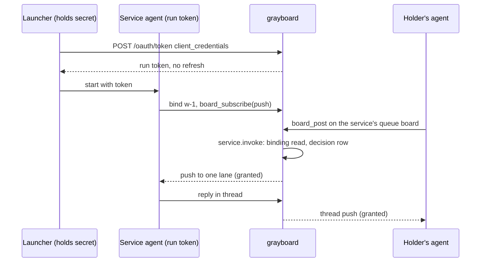

# Service principals

```doc-meta
owns: the design of service principals on the server (#270): the principal and its owners, the non-interactive credential and run tokens, a service's names and session caps, service-scoped queue boards, the `service.invoke` verb
invariants: a service is a `users` row and a `principals` row of kind `service`, keyed by its name, never an email; every service has an owner binding held by a user; principal kind and credential source are immutable after insert (the caches rely on it: `principals` and `service_credentials` have no generation trigger); a credential's expiry is its grant's `expires_at`; the credential secret reaches the launcher only, an agent holds a run token; run tokens are opaque rows re-read on every call, so lifetime is never the revocation mechanism; revoking a credential or disabling the service ends its sessions in the same transaction; a user never acts in a service's scope and a service acts only in its own; a service board's posters hold `service_invoke`, directly or through a team, its lanes are the service's own sessions; grayboard routes an invocation to one lane and never starts one (principle 7)
code-pointers: src/server/oauth.ts (token route, clientAuth, authenticate), src/server/oauth-config.ts (sourceKeyFor, harnessFor), src/server/db.ts (users, principals, oauth_grants, oauth_tokens, setDisabled, endHostedWhere, authGenerationTriggers, findActiveAccess), src/server/http.ts (admin user routes), src/server/policy.ts (actIn, wakeRule), src/server/access.ts (boardAccess, principalSees), src/server/application.ts (userPrincipal, bindTarget, writerMarks, helloOkFields), src/core/boards.ts (Access, queueLanes), src/server/config.ts (DEFAULT_HOSTED_CAPS, globalAndScoped), adapters/opencode-v2/src/binding.ts, adapters/opencode-v2/src/lifecycle.ts (Options.issuer)
companions: ../server-services.md (as built: the principal and `service.invoke`), ../server-access.md §1 Role bindings and ../architecture.md §2 (the as-built binding store and `service_invoke`, #927), postgres-server.md (D2, D3, D5, D7), ../server-oauth.md, ../server-access.md, ../server-hosted-ownership.md and ../boards.md (which take the as-built facts), ../vision.md (§1; principles 2, 7 to 13), ../parity.md
trigger: Postgres P1c merged (`Repo` methods async, #807 Stage 3), with role bindings (#927) landed first
last-verified: 2026-11-16 (origin/master eec82db1)
```

## Problem

Every credential comes from a person at a browser, so a pipeline's agents can't join as themselves (#270). The pilot gate (#807): a service binds as a service principal, takes work from a queue board only `service.invoke` holders can post to, and replies in thread. The credential must work for hosted OpenCode V2 first, the Rust SDK (#929) second.

Code facts that shape it:

- **The account key is already the principal name.** `AuthedUser.user_email` is read as the acting principal's name (audit actor, limiter key, `ids.principal`, `bindTarget`, `messages.sender_user`); only a few sites hardcode the kind (D1).
- **An IdP is consulted only at sign-in** (each provider's `exchange`, `src/server/idp.ts`, with its domain check; [../architecture.md](../architecture.md) §3); token use checks `users.disabled_at` and the token row.
- **The service kind is reserved, and refused.** `principals.kind`, the address grammar and `aliases.scope_kind` carry it; `actIn` denies it (`scope.service`).
- **The token route knows two grant types**; `resolveClient` (authorize and token) checks a startup map first. Confidential clients use `client_secret_basic` only.
- **The session source is a pure function of the client ID** (`sourceKeyFor`): only OpenCode's CIMD client ID maps `ai.opencode/sessionID`.
- **OpenCode 2.1.4's native MCP OAuth is authorization-code and refresh only** (its `core/dist/mcp/oauth.js`), with static `headers` as the other way to authenticate. The plugin refuses `oauth: false` or a static `Authorization` header (`Binding.endpoint`), and delivery needs a human's `/grayboard-enroll`.
- **A queue post from another account is delivered `ungranted`** (`writerMarks`, `msg.wake`, which carries no board).
- **Any push subscriber that sees a queue board is a lane** (`queueLanes`).
- **Every cap and bucket is per account** (`DEFAULT_HOSTED_CAPS`, the hosted request buckets, the bind limiter): 32 delivery leases and 256 sessions, sized for one person's fleet.

## Decisions

### D1. The principal is a `users` row keyed by its name

- A service is one `principals` row (`kind = 'service'`, `user_id` set) and one `users` row whose `email` column holds the service's name (#284 decision 5: one path for grants, audit and revocation). The name follows the team name rule, so it has no `@`: it can never be a person scope (`addressParts`), never pass `isValidEmail`, and never collide with a real email. `principals.name` is unique across teams and services already.
- Why not a synthetic email (`ingest@…`): it parses as a person scope. Why not a separate table: `oauth_grants`, `hosted_sessions`, `hosted_ownerships` and the `authGeneration` triggers key on `users.id`; a second table forks revocation.
- The kind is `principals.kind`, read with the cached user row (`cachedUser`, on `authGeneration`): no `users.kind` column, one store.
- **Sites that change** (each hardcodes "a user is a person"):
  - `userPrincipal` (`src/server/application.ts`) and the `as` request in `ownAddress` (`src/server/http.ts`): the kind comes from the row.
  - `actIn` (`src/server/policy.ts`): a service acts in its own service scope (`scope.own_service`) and nowhere else; a user never acts in a service scope, owners included (the names' mail is the service's). Principle 9.
  - `helloOkFields` and the hosted instruction text: a service has no `human` handle and no Slack link; the name stays reserved in its scope.
  - `users.signIn` and `upsertByEmail` refuse a service row, so no IdP subject links to one; `unlink-idp`, `team add` and the `admin` verb refuse kind service (#927).
  - The generic admin routes `revoke-session`, `disable-user`, `enable-user` (`src/server/http.ts`, by `findByEmail`, no kind check) refuse kind service: `revokeAllForUser` would revoke every credential's grant with no `service.credential_revoked` row. Services go through `/api/admin/services`.
  - `listForScope("person", …)` in name suggestions takes the session's own scope kind.
  - #930's IdP recheck skips services (no IdP, no refresh); #928's per-provider domain check never sees one.
- Unchanged: `wake.same_user` (a service's sessions wake each other), the limiter keys, attachment quota (#284 decision 13), `hosted.session`.
- **Owners** (principle 8): role `service_owner` in the role table (`ROLES`, `src/server/policy.ts`), holder a user, scope the service. Create requires at least one; the store's revoke refuses the last (#927's last-owner form, the lock on the service's principal row). It is the accountability record and carries no power (open question 2). Disabling a user leaves their bindings: #930 replaces disabled owners, and `disable-user` reports the services it orphans.
- **Not a team member** in this build: `team add` refuses. Membership would carry team-policy wakes and the team's boards and names (principle 9; open question 4).
- **Lifecycle**, all under `/api/admin/services` (so behind `org_admin` and its decision row, R10) and `grayboard admin service create|list|disable|enable|credential add|credential revoke|delete-alias`: create inserts both rows and the owner bindings in one transaction; disable is `setDisabled` (it already revokes grants and ends hosted sessions); nothing deletes a service (`role_bindings`' `ON DELETE RESTRICT`, ../architecture.md §2). Audit actions `service.created`, `service.credential_added`, `service.credential_revoked`, with `auth.user_disabled`/`auth.user_enabled` as today. No MCP tool (principle 2).

### D2. The credential is OAuth client credentials; agents hold a run token

Two tiers, because the two first clients differ: the Rust SDK can call the token route, OpenCode can only send a static header.

- **Credential**: a confidential OAuth client owned by one service: `client_id`, a secret (32 random bytes, shown once, SHA-256 at rest like `clientSecretHash`), a session source (D3), a run-token lifetime and an optional expiry. Table `service_credentials`; secrets in `service_credential_secrets(id, credential_id, hash, created_at, revoked_at)`. Client IDs are generated under the reserved prefix `svc_`, which `parseOAuthClients` refuses, since the startup map wins over the store. Each credential has one `oauth_grants` row (user = the service, client = its `client_id`, the server's MCP `resource`, both `OAUTH_SCOPES`: `findActiveAccess` matches the resource, push lanes need `grayboard:delivery`), so "the grant names the principal and the client" (#226) holds.
- **Expiry is the grant's.** The credential's expiry is written to `oauth_grants.expires_at` (far-future when none); on this path it replaces the `OAUTH_TTL.grant` 90-day deadline. Why: the access cache checks `grantExpiresAt`, and `authGeneration` triggers cover only `oauth_tokens`, `oauth_grants`, `users`, so an expiry held only on `service_credentials` would never reach it.
- **Run token**: `POST /oauth/token` with `grant_type=client_credentials` and `client_secret_basic` inserts one `oauth_tokens` access row under the credential's grant and returns it with no refresh token (RFC 6749 §4.4.3), audited `oauth.token_issued` (client, `secret_id`, expiry). `authenticate`, `findActiveAccess` and the cache serve it as any access token.
- **Who holds what.** The launcher (broker, CI step, SDK process) holds the secret and mints one token per run; the agent gets only the token, so a prompt-injected agent can leak a run token, never the credential.
- **Lifetime.** Set per credential by the admin, default `OAUTH_TTL.access`, ceiling `GRAYBOARD_SERVICE_TOKEN_MAX_SECONDS` (default 24 h). Never past the grant's expiry. A static-header client needs a token that outlives its run; one with a token path asks again at expiry. Tokens are re-read per call, so lifetime bounds only an unnoticed leak (principle 11).
- **Rotation without downtime.** A credential holds up to two live secrets. `credential add --rotate <client_id>` adds the second; the launcher switches; `credential revoke --secret` removes the first and revokes its tokens (`oauth_tokens` gains a nullable `secret_id` referencing the secrets table). Client ID, grant and hosted session IDs don't change, so a session presenting a new token continues.
- **Revocation.** Revoking the credential revokes its grant: `endHostedWhere(grant)` ends every session attached to it in that transaction, and the trigger bumps `authGeneration`, so the next call and every open stream's next check refuse (#270 criterion 3, the path #226 §3.4 built). Disabling the service does the same for all its credentials; enabling revives none of them, as for a user (F-14).
- **Bounds** (principle 13): a per-credential mint bucket and a cap on unexpired tokens per grant, checked in the insert, which on Postgres also locks the credential row (postgres-server.md D3); `cleanup` deletes expired rows.
- **AS changes**: `resolveClient` falls back to the store for a `svc_` ID (one indexed read, before CIMD); the grant-type switch and `grant_types_supported` gain `client_credentials`, which never runs for a startup or CIMD client. A service client is refused at `/oauth/authorize`, so auth-code and refresh never run for it. Token-route refusals keep their limiter and audit rules (`server-oauth.md` §1).
- **Rejected:**
  - A long-lived bearer as the credential: the secret sits in every agent's config.
  - RFC 8693 exchange or a JWT bearer from the operator's issuer: a new outside trust surface (JWKS, subject mapping) for what a held secret does (open question 5).
  - The CLI's `gbrd_v1_` tokens: hosted MCP adopts only the OAuth principal.



### D3. The session source belongs to the credential

- `service_credentials.source` is `opencode` (`ai.opencode/sessionID`) or `generic` (`io.github.nolnoch.grayboard/sessionID`); #271's header source is a third value later. `sourceKeyFor` and `harnessFor` read it from the credential, carried on the cached access read, so the hot path adds no query. The source is still chosen by the grant's client, never by the request (#226 §1).
- **OpenCode V2 first.** The native entry carries `oauth: false` and `Authorization: Bearer <run token>`; static mode makes `Binding` accept exactly that shape and treat a 401 as terminal for the run. The mode is taken only from launcher-set environment or CLI input, never project config (a repo's `opencode.json` must not turn it on), and requires a pinned issuer (`Options.issuer`, which `Binding` already checks). Enrollment needs no `/grayboard-enroll`: the plugin enrolls its root when the pinned issuer matches and the server's `whoami` reports `principal_kind: "service"`. Not an agent approving itself (principle 10): the launcher wrote the credential, the mode and the pin, and the kind comes from the server.
- **Rust SDK second** (built, #929: as-built facts in ../sdk-rust.md §5): `ClientCredentials` mints and renews its own run tokens at the token route, `generic` source, `HostedClient` (`adapters/hosted-core/src/client.ts`) as reference.
- **Hosted core third** (built, #1243: as-built facts in ../adapters-hosted-login.md §Hosted core static mode): pi, omp and the Claude Code plugin take the launcher's run token from the environment (`GRAYBOARD_AUTH=static`, `GRAYBOARD_ISSUER`, `GRAYBOARD_RUN_TOKEN`, optional `GRAYBOARD_PRINCIPAL`), `generic` source; the pin and a keyless `whoami` reporting a service are checked before the token is used, and a person's token is refused.

### D4. Names, sessions and caps

- A service session starts unbound and binds like any other; a bare name is `<service>/<name>` (`scope_kind = 'service'`, the form #284 fixed, not #270's `owner@org/name`). Admission, ownership history, grant attachment and the BindGate are untouched: they key on user ID, client ID and grant.
- One live session per name holds (`../handles.md` §1). A service running N agents binds N names; it pools them (`w-1`…`w-n`) because aliases are durable and `ALIAS_SCOPE_CAP` bounds a scope. `admin service delete-alias` is the team route's twin for an unheld name.
- Two credentials of one service are two OAuth clients: their sessions read as missing to each other (`hosted.other_client`).
- **Caps get a service tier**: `sessions`, `leases`, the hosted request buckets and the bind bucket each gain a per-service value in `src/server/config.ts`, picked by the principal's kind at admission: no per-row read on the hot path. Like the per-user values it is clamped under the global caps (`globalAndScoped`) and sized against them, so one service can't starve people. Why not raise the per-user values: they bound what one phished person's grant holds.
- `alias.see` for a service scope: the service itself and `service_invoke` holders, direct or through a team (rule `alias.see_service`, a binding read per service-scope row in `peer_list`, with the actor's team set read once per request: R5), as a team's names are its members' (#348).

### D5. A service board is a queue board in the service's scope

- `boards.scope` gains `service:<name>` beside `team:<name>`. A **queue** board a service session creates is service-scoped; its broadcast boards are org-open as anyone's. No new tool argument (principle 2: every session would pay for it); `checkCreate` refuses the scope to any other principal.
- **See and post**: the service, and principals that hold `service_invoke` on it, directly or through a team (D6). Anyone else reads "no such board", as for a team's.
- **Consume**: only the service's own addresses are lanes. `queueLanes` asks a new optional `Access` hook whether a handle may be a lane on the board; local mode omits it. Without it a holder who subscribes in push mode takes work meant for the service.
- Rotation, the claim-is-delivery rule, TTL redelivery and archive are `../boards.md` §3's, unchanged. With no live lane a post waits on the board: starting a worker is the service's own controller's job (principle 7), and no event hook is added.

### D6. `service.invoke`

- **Meaning**: posting on a service's board. Not a new tool, not `delegate` (#874), not a DM. grayboard checks the right, picks a lane by rotation and delivers.
- **The grant** is a `service_invoke` binding (#927): holder the invoker, scope the service. Holder kinds: user, service and team (the maintainer, 2026-11-16: a whole team must be grantable from the start). A user holds the right through a direct binding or through a binding held by a team they are a member of; a service is never a team member (D1), so it holds it only directly. An actor bound to a team-scoped name (`eng/w-1`) is the team principal (`principalOf`): it holds the right only by that team's own binding. One statement, driven from the actor: probes of the unique `(principal_id, role, scope_id)` index (#927) for the actor's principal and, for a user, each team principal reached from `team_members` by user (joined through `teams.name = principals.name`, unique, or `idx_principals_team`): 1 + the actor's team count indexed probes, never a scan of the service's holders (principle 13). Membership is read live (no cache, principle 11), so removing a member ends their team-derived right at the next check. An allow through a team records the team's binding id and the member's team, so an audit ties the invocation to the membership that carried it; losing that right writes no `role.revoked` row, only the membership's removal.
- **Delegation is a separate grant.** `service_invoke` lets a principal ask a service for work; whether the service starts a worker to do it is the service's own behaviour, accepted when the grant is given. #874's `delegate` grant (one agent sending work to another agent) is unrelated and never reads `service_invoke`.
- **Verb** `service.invoke` in `authorize`, decided for the acting address's principal where the tool call is handled (`src/server/application.ts`), inside the post's transaction (principle 11; server-access.md §1: no cache). Allow: rule `role.service_invoke` with the binding id (R5), or `service.own` for the service's own post. Deny: rule `role.service_invoke`, code `not_found`, the same text as a hidden board, recorded after the rollback. Allows are recorded too: an invocation exercises a grant (principle 8).
- **Waking** (principles 9, 10). `msg.wake`'s request gains the post's board, and `writerMarks`' cache key includes it; `unwoken` stays DM-only. Rule `wake.service_invoke`: a post on a `service:<name>` board wakes across accounts when one side is that service and the other side's acting principal (the same principal `service.invoke` decides on) holds `service_invoke` on it, in both directions, re-decided at each pull or read; a team-held binding counts for the team's members. A binding revoked, or a membership removed, in between turns both to `ungranted` data. DMs between a service and a holder stay mail.
- **Granting** is `grayboard admin role grant service_invoke <principal> --scope <service>` (R10), `org_admin` only for now; `<principal>` may name a team. A team's owners can then extend the right by adding members (`team.manage`, #927): accepted for now, with a fast-follow to tighten it (Risks R8).

### D7. Local mode

Every local cell is n/a (`../vision.md` §1, `../parity.md` §Maintaining parity): one principal, nothing to authenticate or grant.

### D8. Sequence

After P1c, each PR against the async store; DDL twice (SQLite, then P3) as role bindings did (#927) until P5.

1. **#927** (role bindings) lands first: D1's owners and D6 need the table.
2. **Principal** (built: as-built facts in ../server-access.md §1, ../architecture.md §2 and ../handles.md): the `service` rows, D1's site changes, `service_owner`, the admin routes and CLI (`create|list|disable|enable|delete-alias`; `credential add|revoke` come with step 3). Until step 3 no token reaches a service: tests issue one in-process (`tests/helpers/oauth.ts`). Left for later steps: `alias.see` for a service scope has no rule yet (a user is refused it, so service names are visible only to the service). Its follow-ups #1240 (a service's bind in another team's or service's scope reads as a missing scope) and #1241 (service texts for the wake note and cross-user delegation, `peer_list`'s ID rows judged by the service scope, the name `human` refused) landed with step 3.
3. **Credential** (built: as-built facts in ../server-oauth.md §2 Service credentials, ../server-access.md §1, ../architecture.md §2, ../guide/server.md and ../parity.md row 21): `service_credentials`, `client_credentials`, source mapping (server side), caps tier, revocation, `credential add|revoke`. As built: a credential with no expiry gets the far-future `CREDENTIAL_NO_EXPIRY`; the mint bucket counts a minute's mints per credential (`GRAYBOARD_SERVICE_TOKEN_MINTS_PER_MINUTE`, default 60), the cap its unexpired, unrevoked tokens (`GRAYBOARD_SERVICE_TOKENS_UNEXPIRED`, default 1000), and either answers `slow_down`; a credential's last live secret can't be revoked alone; the service tier of the rate buckets has no global clamp, as the user tier has none. The OpenCode half of criterion 2 is step 4's.
4. **OpenCode V2** (built: as-built facts in ../adapters-hosted-login.md §OpenCode V2 static mode, ../server-oauth.md §2, ../guide/harnesses.md and ../parity.md row 21): the static credential mode and service enrollment. As built, unlike D3's text: the mode and its pin come only from the launcher's environment (`GRAYBOARD_AUTH=static`, `GRAYBOARD_ISSUER`; hosted core's names since #1300), not `Options.issuer`, because plugin options come from any config layer, a repository's included; a dotenv file in the working directory that names either variable refuses the mode, since Bun loads it into the environment; the pin is bound to the entry by the server's protected-resource metadata; a 401 is `AccessExpired` `login_required`, the Controller's existing no-retry pause; the `whoami` that decides auto-enroll carries no session key, so it creates no hosted row; `setup-opencode` gains no flag, since the launcher writes its own per-run config and setup leaves a static entry alone. Added by its audit: an optional `GRAYBOARD_PRINCIPAL` names the service whose token may auto-enroll, and the enrollment must read the same entry the kind check did. Left open: R7's residual (the opened repository and the agent can read the token).
5. **Boards and invoke** (built: as-built facts in ../server-services.md, ../server-access.md §1 (`msg.wake`), ../boards.md §3 Service boards, ../architecture.md §2 and ../parity.md row 22): the scope, the lane hook, the verb, the wake rule. Closes #807's exit test on SQLite; P3 re-runs it on Postgres. As built, beyond D4–D6's text: a session's ID is judged as its session's primary on a service's board and names, for seeing as for posting (one derivation on every route), or a session bound only to a team-scoped name would see and invoke through its user's direct grant whenever it acted as its ID (core picks the first of the session's addresses that sees the board); a queue post's claim on a hidden board is no claim to the caller (`claim_list`, `claim_watch`, `claim_release`), since its key names the board; `claim_take` naming a service's board (MCP and the HTTP claim route) is decided as a post, since its announcement is one; the one-name mention claim asks the lane hook too, and an invoker named in a post is told while the post waits on the board (a visible name skips the rotation, `../boards.md` §3); `alias.see_service` reads the grant once per service scope a call touches, the team set inside that statement, not once per request; after a revoke the holder's pending replies drop, as from any board it can't see, so only the service's side is delivered `ungranted`. R5: `scripts/loadtest.ts` has no service path; measuring this read needs a share of its sessions on run tokens, a service queue board and invokers granted through teams of a set size.
6. **Rust SDK** (built, #929: ../sdk-rust.md §5): `ClientCredentials` and its revocation; the conformance driver mints its own tokens.
6a. **Hosted core** (built, #1243: ../adapters-hosted-login.md §Hosted core static mode, ../guide/harnesses.md, ../parity.md row 21): static mode for pi, omp and Claude Code. The harness label is built (#1298, ../server-sessions.md). `BUS_LAUNCHER` for a service session is built (#1299, ../delegation.md). Left: one variable set across hosted core, OpenCode V2 and the Rust SDK (#1300).
7. Later: #271 (header source), #874 (delegation, its own `delegate` grant, independent of `service_invoke`: D6), #930 (owner offboarding; per-grant list covers credentials), #928 (nothing here).

The implementing PRs add one `../parity.md` row each for the credential and for invocation, and move as-built facts to the companions; this file is then deleted.

## Tests, by acceptance criterion

On `TestServer` with `accessAudits` unless said.

1. **Created and revoked, both audited** (#270): create with an owner, add a credential, revoke it, disable the service; each row names the admin and the service. Create with no owner, with a team's name, or an email-shaped name is refused. One `runCli` pass against a `ServerProcess`.
2. **A token with no browser, bind, post** (#270): a raw `fetch` to `/oauth/token`, then a `HostedSession` with the run token (not `srv.hosted`, which mints a built-in client's token in-process) binds `<service>/w-1` and posts, against a `ServerProcess`. The OpenCode half is the adapter's `test:native-host` with a static-header entry; the conformance suite's hosted driver (#926) runs its scenarios under a service token, and #929 repeats them through the SDK.
3. **Revoke ends sessions** (#270): with a bound, delivery-open session, revoking the credential leaves no `hosted_sessions` row (`hostedRowCount`), closes the stream and refuses the next call; the same for disable; rotating a secret keeps the session. A second case revokes with raw SQL on another connection (#927's test for the same reason).
4. **Pilot gate** (#807): a holder's post reaches exactly one service lane, actionable; the reply wakes the holder; a member of a holding team posts and is woken the same way, and after `team remove` is refused; a session bound to a team-scoped name is refused unless that team holds the right, even when its user holds it directly; a non-holder's post is refused as a missing board with a deny row; a holder's push subscription never becomes a lane; after the binding is revoked the queued item is delivered `ungranted`.

Also: `policy.ts` unit tests per rule; a user can't bind in a service scope and a service can't bind in a person's or a team's; a Google or dev sign-in can't link to a service row; `upgrade.test.ts` opens a release database unchanged; the mint cap and the grant read each get postgres-server.md D9's interleaving test at P3; `scripts/loadtest.ts` holds R5's binding reads inside the request budget.

## Risks

- **R1. OpenCode's host behaviour under `oauth: false`**: verified on OpenCode 2.1.4 by step 4, in direct and code mode. A `tools/call` on a static-header entry carries `_meta["ai.opencode/sessionID"]` (added in `@opencode/core` `mcp/client.js` whatever the auth) and `Authorization: Bearer` with the value of the launcher's variable (`{env:VAR}` is substituted in config files); the entry connects with no integration. `adapters/opencode-v2/tests/static-host.ts` keeps proving both.
- **R2. A leaked run token is the service until it expires or is noticed.** Bounded by the lifetime ceiling and individual revoke (`/oauth/revoke`); the secret is not exposed by it.
- **R3. A service board is one room**: every holder reads every request and reply; confidential work needs a service per audience.
- **R4. Invocation rows.** One `authz.decision` allow per invoking post grows `access_log` at agent rate, bounded by post limits and retention; if it measures badly, the binding id on the post replaces the allow row.
- **R5. Hot-path binding reads** (#927), each with the actor's team-membership read. Not one per post: for a service board, `boardAccess.canSee` → its principal rule (`principalSees`, `src/server/access.ts`) reads the binding on every visibility check, so in `board_list`, `board_read`, the snapshot, the catalog, mention resolution and once per lane in `queueLanes`; plus `alias.see_service` per service-scope row in `peer_list`, and the post's `service.invoke`. #927's "CLI routes, at human rates" understates this. The load test drives each path. A cache, if needed, joins postgres-server.md D5's generation and `NOTIFY` set or misses outside revokes.
- **R6. `user_email` now names non-emails**: code that splits it on `@` or mails it breaks for services. A rename is mechanical and separate.
- **R7. Auto-enrollment trusts the launcher, the opened repository and the agent.** Project config can't set the mode, the issuer or the principal, and a person's token gets no auto-enroll (the server reports the kind). Residual: whoever controls the launcher's environment controls mode, pin and token, and a service's operator can enroll roots no human looked at, which is the service's accountability, recorded by its owners. Measured on OpenCode 2.1.4 by step 4's audit: the opened repository and the agent can read the run token (project config loads from every ancestor unless the SDK host sets `project: false`, with `{env:}` and `{file:}` substitution and same-name entries replacing the launcher's; repository plugins, local MCP servers and the agent's shell see the environment), and the host sends it before any plugin code runs. A per-run config dir or variable name doesn't close that. Controls: isolation (`project: false`, or a sandbox whose egress reaches only the grayboard server and the model provider), `token_seconds` about the run's length, revocation at run end, a service per trust class; sender-constrained tokens would close replay.
- **R8. Team owners are de facto granters.** A team holding `service_invoke` lets its owners give a service's invoke right to anyone by adding them to the team, with no `org_admin` involved. The maintainer accepted this to start (2026-11-16); the fast-follow narrows it (for example, team grants only by a service owner once open question 2 lands, or membership changes on holding teams audited as `service_invoke` changes).

## Where #270, #807 and the code disagree

- **"The `hd` check on every token use"** (#270): the code checks Google's `hd` and the org domain at sign-in only.
- **`owner@org/name`** (#270 Details): superseded by #284 decision 5 (`<service>/<name>`), which the address grammar implements.
- **"Pull-only"** (#270 Value, #271): queue rotation picks push subscribers, so the OpenCode path keeps delivery; pull-only is #271's client.
- **"Usable by opencode-v2"** (#807): OpenCode's native OAuth can't do client credentials, and the plugin refuses static headers and needs a human's enrollment (D3).
- **`service_invoke` holder kinds and cost** were left to this doc (#927); with team holders the read is 1 + the actor's team count indexed probes, not #927's one lookup, still bounded by the caller's own state (principles 11, 13); `service_owner` is a role #927 doesn't list.
- **#874** proposes its own grant row for "an org service opened broadly"; its `delegate` grant stays its own and never reads `service_invoke` (D6).
- **"A synthetic, non-addressable key"** (the maintainer's #270 comment on `users.email`): D1 uses the bare service name, which is no address on the server (a bare name resolves in the caller's scope).

## Open questions

Sent to the maintainer with defaults; with no answer, the defaults are the design.

1. **An "everyone in the org" holder.** #874 expects a service opened to all members; no principal means that. Default: per-principal grants; an org-wide principal is its own issue.
2. **What an owner may do.** Grant `service_invoke` on their service, rotate its credentials. Default: nothing yet; `org_admin` does both.
3. **How a service board is made.** Implicit by kind (D5), or an explicit `scope` argument on `board_create`. Default: implicit.
4. **Services as team members**, to read a team's boards. Default: no.
5. **Workload identity** (a JWT bearer from the cluster's issuer in place of a held secret). Default: after the pilot.
6. **Per-service caps** beside the one service tier. Default: the tier only, until a second service needs different sizing.
7. **The wake grant's width.** Board posts only (D6), or every message between a service and its holders. Default: board posts only.
